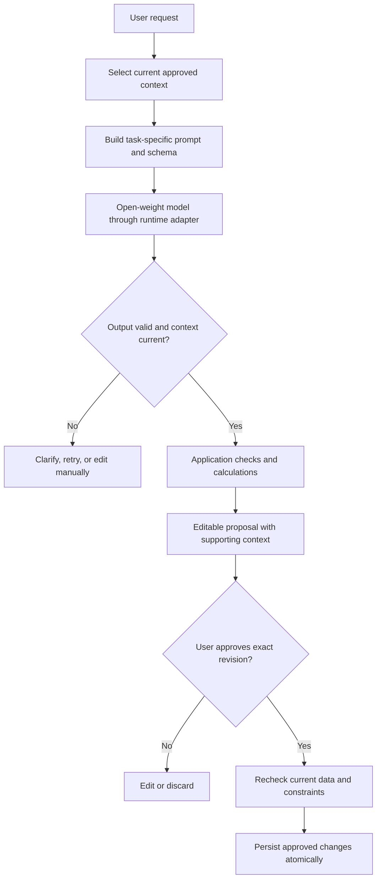
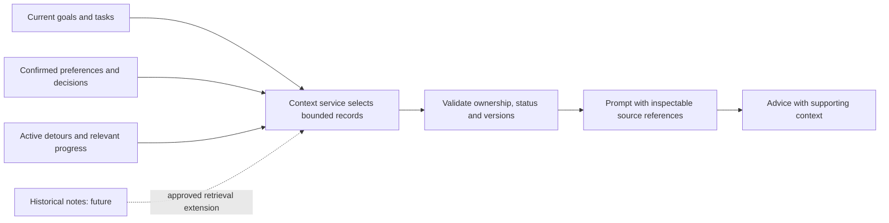

# Trajectory — AI Integration

> **Status: Integration requirements/proposals by phase.** Running.md and Model_Verification.json record the current Qwen3 4B/Ollama implementation and smoke evidence; this alignment performs no new model/license/runtime verification and claims no challenge eligibility.
> Sources of truth: `setup/Product.md` and the approved `setup/Architecture.md`. Their unresolved choices remain open. This document specifies integration behavior; it authorizes no implementation. `setup/Design.md` remains outside this alignment scope.

## 1. The integration at a glance

Think of the model as a planning adviser: it can interpret a request and suggest useful work, while the application checks what fits and the user decides what to save.



Any failed final check returns a review/error result rather than saving. Generation does not silently replace an accepted plan. The browser talks to application routes, never directly to inference or persistence.

| Term | Plain-language meaning |
| --- | --- |
| Model | The trained weights used to generate suggestions. Open weights do not automatically imply an unrestricted open-source license. |
| Runtime | Software/service that loads and executes the model, such as a compatible local Ollama installation. |
| Adapter | A small backend interface hiding runtime-specific request/response details. |
| Contract | The exact allowed structure and meaning of inputs and outputs. |
| Retrieval | Selecting relevant saved records for a request. This can use ordinary database queries. |
| RAG | Retrieval-augmented generation: supplying retrieved material to the model; not a guarantee against hallucinations. |

## 2. MVP scope and deterministic boundaries

Current AI scope is limited to Goal-to-Plan and the simple Daily To-do Planner in Product.md Section 4. Both return structured, editable proposals for user review. Daily planning is current; calendar scheduling, bulk course schedule/deadline imports, complex course management, automatic milestone management, advanced forecasting, autonomous agents, Sketch AI and other advanced workflows are deferred. The cross-phase matrix below retains future boundaries without making them current contracts.

| AI proposes | Application owns | User controls |
| --- | --- | --- |
| Current: goals, actionable work/checkpoints and clarification questions. Interests/context extraction is deferred. | Required fields, valid units/dates, record ownership and references. | Review/correction before extracted details become saved facts. |
| Current: priorities, suggested time allocations and brief reasons for tomorrow's to-dos. | Allowed deadline options, current task references/progress and allocation totals versus supplied available time. Interval placement is deferred. | Edit and explicitly accept a plan. |
| Deferred: possible priority mismatches and exploration questions. | Current confirmed priorities, active detours, source status/version checks. | Decide whether an activity is an intentional detour. |
| Deferred: preference/decision summaries grounded in supplied context. | Confirmation, persistence, correction/deletion and invalidation. | Inspect and amend stored context; confirm important changes. |

**Deferred Phase 2 scheduling proposal, not the simple daily planner:** Ask AI for ordering and allocation suggestions, then let deterministic scheduling code place work in valid intervals. User-edited times are checked by the same code. The architecture permits editable schedule suggestions; this narrower contract avoids relying on model arithmetic. The placement/prioritization policy remains OPEN DECISION and must be approved before implementation. The model must never override a scheduling constraint.

Advanced forecasting is deferred; its retained boundary remains entirely application-owned: recorded completed work, remaining workload and approved future-capacity assumptions feed a testable calculation. Time spent is distinct from completed quantity. Incompatible units or insufficient evidence produce an unavailable/uncertain estimate. No model-generated completion date is accepted as a forecast. Phase 2 can show template-based forecast explanations without a model call; optional model paraphrasing may not change computed values.

**Future only:** Broad historical-note/conversation RAG, embedding/vector search, longer-term roadmap suggestions, richer exploration reviews, autonomous multi-step tools, and the Phase 4 Sketch Journal/artistic development module (Product.md Section 6). A suitable vision model may later support uncertain visual observations and practice suggestions; media privacy, model selection and evaluation are open, with no Phase 1 integration required. No agent framework is justified for the bounded workflows below.

## 3. Model and runtime selection

### 3.1 Evidence before selection or replacement

The table preserves selection gates, not a claim that current implementation evidence is absent: Running.md and Model_Verification.json record the selected local artifact, configuration and limited observed behavior. Challenge eligibility and broad quality are not established by smoke checks. For a new selection or replacement, do not choose a model because its name appears in a runtime catalogue. For each candidate, retain this evidence in the later approved decision/submission records, not in invented verification claims.

| Selection gate | Evidence needed | Current state |
| --- | --- | --- |
| Open weights and identity | Official publisher/model card, exact repository/revision or artifact digest, weight availability and provenance of any quantization. | Existing local identity evidence: Running.md / Model_Verification.json; reverify for replacements. |
| License and challenge fit | Exact model-specific license and conditions; compare attribution, use, redistribution and hosting restrictions with official challenge rules. Runtime license is separate. | Existing license references: Running.md; challenge eligibility remains unverified. |
| Runtime compatibility | Supported architecture/format, exact runtime version, adapter capabilities and successful load on the target device/service. | Local smoke evidence recorded; no new runtime tests here. |
| Hardware fit | CPU, OS, RAM, GPU/VRAM, driver support, model/quantization size, context size, and measured cold/warm memory behavior. | Hardware observations: Tasks.md / existing verification; no new measurements here. |
| Task quality | Extraction, structured responses, clarification, grounded alignment, and intentional-detour evaluation results. | Limited goal-proposal smoke evidence exists; broader phase-specific evaluation remains pending. |
| Practical demo | Measured response time, failure recovery, storage/network availability and permitted demo format. | Local single-user app is approved; hosted routing, budget and demo eligibility remain separate decisions. |
| Data handling | Where prompts go; provider retention/access terms if hosted; user disclosure and approved personal-data handling. | Not approved. |

**Proposed process:** Establish hardware/time/budget constraints, then shortlist a small number of compatible instruction-tuned open-weight candidates. Compare exact artifacts on the same synthetic task set. Choose the smallest candidate that meets approved quality and response-time criteria; model size alone is not evidence of quality. Do not download or install anything during documentation.

### 3.2 Inference routes

| Option | Benefit | Limitation / decision |
| --- | --- | --- |
| Local compatible Ollama runtime | Separate model process behind a simple backend adapter; can support schema-constrained responses. | Actual model/device compatibility, memory and latency need measurement; local does not establish offline/private operation. |
| Hosted open-weight inference | Potential option when the demo device cannot run the model adequately. | Verify exact served model, API capabilities, provider terms, cost, connectivity, secret handling and challenge eligibility. |
| Different compatible local runtime | Possible if the selected model or device cannot use Ollama. | Review dependencies/capabilities first; preserve the same adapter and application boundaries. |

Official [Ollama hardware guidance](https://docs.ollama.com/gpu) and [FAQ](https://docs.ollama.com/faq) inform checks but do not verify this machine. A remote web server's localhost is not the developer's laptop. Do not expose a personal inference endpoint publicly as a shortcut.

Ollama documents schema-constrained responses in [structured outputs](https://docs.ollama.com/capabilities/structured-outputs); that page currently states that Ollama Cloud does not support this feature. Treat each inference route's capabilities separately. A schema-capable local endpoint does not prove equivalent hosted support or correct response meaning.

## 4. Input and output contracts

These are proposed logical contracts, not executable schemas or finalized route/database fields. Contract versions must be pinned with prompt/model settings during evaluation. Pydantic is the approved validation direction; this document authorizes no installation or code change.

### Current and deferred contract boundaries

**Current Goal-to-Plan:** A bounded proposal must distinguish goal facts from assumptions/questions and include reviewable milestone checkpoints/completion criteria and ordered actionable tasks, with effort suggestions adjustable or unknown. Draft-local keys are not persistent task IDs. Exact approval creates or links persistent work under reviewed identity/version rules. Current executable proposal bounds and approved-plan storage are documented in Running.md; the tables below retain logical proposals across later phases, not replacement schemas.

**Current Daily To-do Planner:** Inputs are the user's tasks for tomorrow, one allowed deadline choice per task, available time and relevant recorded progress/current unfinished work. Product.md owns the four options and unresolved deadline semantics. No goal/milestone link, dependency graph, course schedule, recurring window or minimum-session field is required.

AI proposes priorities/order, reasonable time allocations and brief reasons. Use existing confirmed task identities once tasks are saved; new entries must not masquerade as existing tasks. Suggestions may leave work unallocated but must explain it without silently dropping a task. A proposal uses current completion/progress and must not mark work complete, alter deadlines or promise completion dates.

Each daily plan is a fresh editable proposal, separate from persistent to-dos and recorded progress. Application validation checks allowed inputs, current references and allocation totals against supplied available time; it rechecks current data before acceptance. New days do not reset progress, duplicate unfinished tasks or automatically extend deadlines. Exact request/response fields, time units and retention/replacement policy remain open; no executable contract is selected here.

### 4.1 Backend request envelope

| Field | Expected value and rule |
| --- | --- |
| `request_id`, `operation` | Application-issued identifier. Current operations cover goal/checkpoint proposals and daily to-do planning; exact operation names remain under contract review. Alignment/context_summary are deferred. |
| `contract_version`, `prompt_version` | Backend-controlled versions; never chosen by model output or browser input. |
| `user_input` | Bounded text supplied for this action, treated as data within application policy. |
| `context` | Selected confirmed records with typed IDs, versions, status and content needed for this operation. |
| `source_revision` | Application-owned snapshot revision/version token; rechecked before showing or applying results. Not a value trusted from the model. |
| `planning_inputs` | Current daily planning: saved candidate task identities/titles, deadline choices with application-confirmed meaning, available time and recorded progress/unfinished work. Goal/milestone links are optional. Dependencies, detours and interval capacity are deferred. Exact field names remain proposed. |
| `response_schema` | Backend-selected schema for this operation. No generic executable action language. |
| Runtime limits | Server-controlled timeout, input/context budget, output byte/token limits and generation settings; exact values remain OPEN DECISION. |

The adapter receives only necessary prompt/context fields; request/ownership metadata can stay in application memory. The application associates the result with its original request instead of relying on the model to echo security or revision metadata correctly.

### 4.2 Common model response

| Field | Contract |
| --- | --- |
| `status` | proposal / needs_clarification / no_suggestion. This is never an accepted/saved status. |
| `questions` | List of short clarification questions, with the missing/conflicting field identified. |
| `items` | Operation-specific typed proposal items; empty when clarification prevents a meaningful proposal. |
| `explanation` | Brief user-facing rationale; no request for hidden chain-of-thought. |
| `source_refs` | Typed IDs and versions from the supplied context, checked against the request's allowlist. |

Reject unknown fields, invalid types, unbounded arrays/text, contradictory statuses, unrecognized identifiers and unsupported actions. A schema-valid explanation can still be false. “No suggestion” is a model response; unavailable inference is a separate adapter failure. Do not use a model's numeric confidence as calibrated evidence.

### 4.3 Operation-specific items

| Operation | Item fields | Meaning and checks |
| --- | --- | --- |
| Goal/work extraction (current); interest/preference fields deferred | `proposal_key`, `kind`, `title`, optional `details`, `deadline_text`, `priority`, `effort_minutes`, `progress_unit`, `remaining_quantity`, `source_refs` | Allowlisted work/task/interest/preference proposals; missing values stay absent/NULL. Keys identify draft items, not database rows. Ambiguous dates or effort require clarification; do not invent defaults as confirmed facts. |
| Daily to-do planning (current; fields proposed) | `task_id`, `rank`, `suggested_minutes`, `reason`, `source_refs` | Existing confirmed tasks only; positive integer minutes, unique task IDs/ranks, no forecast dates or authoritative timestamps. Validate totals against available time; known remaining effort is optional, not a required user input. |
| Alignment (deferred) | `activity_key`, `assessment`, `possible_mismatch`, `question`, `source_refs` | Assessment: consistent / possible_mismatch / insufficient_context. No persistent distraction label. A mismatch asks whether exploration is intentional; insufficient evidence prompts clarification. |
| Context summary/change (deferred) | `proposal_key`, `kind`, optional `target_ref`, `proposed_text`, `reason`, optional `detour_scope`, `review_date_text`, `source_refs` | Propose inspectable preference/decision/detour/summary text; target must exist when modifying a record. Dates and exact changes need user review; important goal/commitment changes always require confirmation. |

A natural-language detour request is interpreted into a proposal, not treated as approval of unseen extracted details. New task breakdowns go through extraction/confirmation before they become planning task IDs. Keep goal/commitment mutations inside validated application workflows; no model-generated SQL, arbitrary patch paths, code or direct writes.

**Planning completeness rule:** The application retains the full submitted candidate set. If the model omits a task, report it as omitted/unallocated or ask for review; do not silently lose it. Validate suggested totals and report omitted/unallocated tasks in code; interval placement and advanced shortfall analysis are deferred. Explicitly distinguish work not requested for today from work requested today that could not fit.

### 4.4 Retained deferred navigator example

```text
User: Keep learning ML, but explore quantum computing on weekends for a month.
Saved context: ML is a current priority; no approved quantum detour exists.
AI proposal: Keep ML as a priority; propose a bounded quantum exploration.
Clarification: Which start/end dates and weekend time budget do you want?
User reviews exact scope/dates -> application validates -> confirms and saves.
Next plan: Include the confirmed exploration without calling it a distraction.
```

This is an invented example of intended behavior, not a test result or a finalized UI journey. “A month” and “weekends” require confirmed interpretation, not silent date/availability changes.

## 5. Prompt responsibilities

| Prompt | Required instructions | Must not do |
| --- | --- | --- |
| Goal/work extraction | Separate stated details from missing/ambiguous values; preserve multiple interests; ask focused questions. | Invent effort, deadlines, preferences or confirmed commitments. |
| Daily planning | Use supplied to-dos, deadline choices, available time and recorded progress; suggest priorities/allocations with brief reasons. Detour context and interval scheduling are deferred. | Claim a schedule is valid, override hard constraints, or guarantee completion. |
| Alignment | Compare with cited current records; explain uncertainty; respectfully ask about intentional exploration. | Shame the user, assume unfamiliar topics are distractions, or change priorities. |
| Context summary | Summarize only supplied evidence, retaining decision reasons and detour scope; label unresolved conflicts. | Turn historical statements or interpretations into current facts without confirmation. |

**Prompt assembly order:** Application policy and task instructions -> output schema -> clearly delimited saved context -> current user request. Delimiters aid readability, not security by themselves. Saved notes, titles, resource content and user text cannot override application policy, enable tools, or access other users' records.

Use compact task-specific examples only when evaluation shows they help. Keep prompts versioned with contracts in the proposed AI module; do not create those files now. Prefer low-variability settings as a test candidate, but do not call low temperature deterministic or assume a seed gives identical outputs on every runtime/device.

## 6. Context retrieval and persistent memory

**Current:** Select bounded goal/to-do records and relevant completion/progress through existing data access. The richer context diagram and memory lifecycle below are retained for the deferred navigator; no context service, RAG, embeddings or full chat archive is required now.



**Phase 3 context retrieval:** Use repository queries by linked goals/tasks, current priorities, active detours and bounded relevant decisions. Include approved summaries only when current and traceable to their sources. Do not require embeddings, a vector database or full chat storage. Resource links are references, not authorization to fetch remote content.

Apply access scope and pending-deletion exclusions before selecting records. Preserve crucial constraints and active detour scope when limiting context. If relevant evidence cannot fit the model's verified context budget, retrieve a narrower set or ask a question; never silently truncate mandatory constraints and then claim the result is grounded.

Structured records define current facts; approved summaries are derived context; historical notes are supplementary evidence. When they disagree, prefer confirmed current state and ask about unresolved conflicts. Show supporting saved context where practical. An ID match proves a reference exists, not that the text entails the model's claim; grounding still needs semantic evaluation and user review.

**Correction/deletion lifecycle:** Invalidate affected drafts, summaries and any future retrieval index. Exclude pending/failed-deletion targets from new advice. Recheck sources before returning an in-flight result and again before approval; discard/regenerate stale results. Do not keep deleted information alive in prompt caches, saved outputs or copied summaries. Deletion completion, backup retention and hosted-provider handling remain OPEN DECISION; do not claim erasure that has not been verified.

**Future RAG:** Introduce historical-note search only after approval and a demonstrated retrieval need. Begin with metadata/text search if sufficient. Evaluate source recall, stale/conflicting evidence, access isolation and deletion propagation before considering embeddings/vector indexes. Retrieval never guarantees hallucination-free advice.

## 7. Validation and approval gates

| Gate | Application action | Failure outcome |
| --- | --- | --- |
| 1. Transport | Enforce timeout, response-size budget and complete response. | Typed runtime failure; never parse a truncated answer as success. |
| 2. Structure | Parse JSON and validate the operation's schema/types/enums/limits. | Reject malformed/extra/unsupported fields; no partial application. |
| 3. References | Check supplied task/source/target IDs, ownership, status and versions. | Reject unknown/stale/deleted references; regenerate or clarify. |
| 4. Meaning | Check dates, quantities, existing versus new tasks, facts versus interpretations, and detour/change semantics. | Ask about missing/contradictory information; unsupported claims stay unverified. |
| 5. Domain | Current: validate deadline choices under the approved semantics, task state, positive allocations and totals versus supplied available time. Deferred: dependencies, interval placement/overlap and forecasts. | Flag/reject invalid allocations; retain omitted/unallocated work and prior saved state. |
| 6. User review | Present exact editable proposal with relevant sources and before/after values for important changes. | Declined/unconfirmed changes do not become facts. |
| 7. Commit | Re-read current versions, revalidate edits/constraints, atomically persist and prevent duplicate acceptance. | Rollback or review prompt; preserve the prior accepted plan. |

All edited proposals pass the relevant gates again. The model does not receive database permissions. No model call runs inside a database write transaction. Deterministic checks reject enforceable errors; they cannot automatically prove every explanation true or detect every subtle prompt injection.

## 8. Adapter, errors, and safe configuration

The proposed adapter contract remains `generate(request, schema, timeout) -> response or typed failure`, as in Architecture.md. It exposes capabilities and normalizes responses; application services own context, validation and persistence. Replacing a model/runtime must not require rewriting forecasting or scheduling.

For an Ollama candidate, the official [chat API](https://docs.ollama.com/api/chat) documents model/messages, JSON/schema formatting and streaming. **Proposed MVP:** request a complete non-streamed structured response and validate it before display as a proposal. This is a configuration recommendation, not a working integration. Do not assume every model supports every option, or enable tools because the API offers them.

| Failure | Expected behavior |
| --- | --- |
| Endpoint unavailable / missing model / credentials rejected | Actionable configuration error, with secrets redacted; preserve saved records. |
| Timeout / context too large / memory exhaustion / rate limit | Stop within configured budgets; explain retry/manual options without claiming success. |
| Unsupported schema capability | Fail explicitly or use a separately evaluated alternative route; never silently weaken validation. |
| Invalid JSON / unfinished output / unknown IDs / impossible allocation | Reject the proposal and provide clarification or user-triggered retry. |
| Stale or deleted context | Discard/regenerate; do not show an old answer as current. |
| Persistence error after approval | Roll back changes and report unsaved status; retry must not duplicate a prior commit. |

Use one bounded call per operation initially, with user-triggered retry and no automatic infinite repair loop. Extraction followed by planning are separate operations/approval stages. Missing data should be clarified before inference when application rules can already detect it. Manual editing and deterministic calculations remain available during inference failure, but that fallback does not satisfy the requirement to demonstrate meaningful open-weight AI use.

Endpoint, exact model identity, timeout, context/output budgets and generation options are backend-controlled configuration. Store credentials outside Git and browser assets. Use approved endpoints only; avoid user-controlled inference URLs, arbitrary network fetches, generated code execution and direct public access to the local runtime. Escape model text before rendering. For hosted inference, approve the destination and personal-data disclosure before sending context.

Log request IDs, operation, prompt/contract versions, exact runtime/model identifiers, duration and safe error categories. Do not ordinarily log raw prompts, personal context, full outputs or secrets. Diagnostic retention and synthetic evaluation artifacts need an explicit policy. Do not store hidden reasoning traces as personal memory.

## 9. Evaluation plan — prove usefulness and containment

No new evaluation, benchmark, real-model call, hardware check or license verification is performed by this documentation alignment. Existing local smoke observations are recorded in Running.md and Model_Verification.json. The plan below defines future evidence, not achieved results. Detailed test ownership belongs in `setup/Testing.md` when authorized.

### 9.1 Two complementary test tracks

| Track | What it proves | What it cannot prove |
| --- | --- | --- |
| Deterministic tests with fake adapters | Parsing, reference checks, permission boundaries, capacity constraints, stale-result rejection, confirmation and rollback. | Real-model quality, speed, memory fit or genuine integration. |
| Real-model evaluation on synthetic cases | Observed extraction/alignment/planning quality and runtime behavior for the exact candidate/settings. | Universal reliability, full privacy or challenge compliance. |

### 9.2 Proposed starter dataset

Current evaluation needs both goal/checkpoint usefulness and daily priorities, allocations and reasons across allowed deadline options, limited time, recorded completion and unfinished work. Select a small approved current-scope subset/adaptation; do not require navigator or advanced scheduling cases now or silently change the proposed counts.

Retain the cross-phase proposal of 20 reviewed synthetic cases: four per group below. Include valid examples and failures; retain expected facts, missing fields, relevant source IDs, allowed proposal behavior and forbidden mutations for each. This size is a starting recommendation, not a statistical reliability claim. Use a separate small development set for prompt tuning; do not silently tune on the final comparison cases.

| Case group | Include | Expected evidence |
| --- | --- | --- |
| Natural-language extraction | Multiple interests, ambiguous dates, missing effort and changing priorities. | Correct stated fields; no invented required values; focused clarification. |
| Planning and overload | Tight capacity, conflicting commitments, omitted tasks and unknown effort. | Useful ordering/allocation suggestions; application prevents invalid plans and reports shortfall. |
| Alignment and detours | New field, confirmed exploration, conflicting old/current decisions and due review date. | Grounded, respectful questions; detours respected; no automatic priority mutation. |
| Grounding and hostile content | Unknown citations, unsupported summary claims, injected notes and out-of-scope record IDs. | Reference/ownership rejection; no tool execution or unauthorized persistence; remaining semantic failures recorded. |
| Failure and lifecycle | Invalid output, runtime failure, context correction during generation and deletion before acceptance. | No partial writes; stale content excluded; saved work preserved; safe retry. |

### 9.3 Measurements and review gates

| Measure | How to record it |
| --- | --- |
| First-response schema validity | Valid complete responses / attempted responses; report failures and timeouts separately. |
| Extraction fidelity and clarification | Compare approved facts and missing fields with expected case annotations; human-review ambiguous cases. |
| Grounding and detour behavior | Human-check whether cited records support claims and whether advice respects current priorities/confirmed exploration. |
| Planning usefulness | Review reasons and task selection against stated priorities; compare with a simple deterministic baseline to show whether AI adds meaningful assistance. |
| Constraint containment | Count accepted plans violating constraints and unauthorized mutations; expected count is zero in the test set. |
| Runtime practicality | Cold/warm end-to-end duration, median and observed range, peak observed memory, context size, timeouts and retries on identified hardware. |

Run each final case three times per candidate/settings as a proposed variability check; report all attempts, including failed ones. Low temperature is not proof of deterministic generation. Report human judgments and disagreements alongside counts rather than using an unvalidated model judge as the only evaluator.

**Proposed release gate:** All deterministic workflow checks pass; zero invalid accepted schedules, unauthorized goal changes, unknown accepted references or known deleted/stale context used in the evaluated workflows. Critical containment failures block release regardless of average quality. Human review must find no fabricated confirmed preferences or punitive distraction judgments in the reviewed set. Numerical quality and response-time thresholds must be approved after constraints/baseline measurements, before choosing a winner. Passing a small set does not guarantee production behavior.

Keep exact model revision/digest, license source, runtime/device configuration, quantization, prompt/schema versions, test-set version and actual results together for reproducibility. Record what AI contributed to the real planning loop; a mocked response, recording alone or decorative chat panel is not evidence of live model integration or challenge eligibility.

## 10. Open decisions and next review

| OPEN DECISION | Input needed |
| --- | --- |
| Challenge eligibility | Official challenge rules/link, deadline and submission evidence requirements. |
| Candidate replacement / broader evaluation | Existing Qwen3 4B/Ollama evidence is referenced above, without making a new selection. Approve phase-relevant quality budgets and any new model/hosted route separately. |
| Later runtime/deployment | Local single-user Phase 1 is confirmed; hosted processing, new endpoints and public access need separate decisions. |
| Current planning contracts | Review minimal goal/checkpoint and daily to-do/progress inputs/outputs against existing contracts. Resolve deadline semantics, allocation units and plan retention/replacement without selecting a schema here. Minimum sessions, dependencies and interval placement are deferred. |
| Budgets and quality gates | Context/output limits, timeout, response-time target and minimum useful extraction/alignment quality. |
| Context and confirmation | Important-change boundaries, detour review behavior, proposal expiry, correction/deletion and retention requirements. |
| Deferred forecast inputs | Units, minimum history, future-capacity assumptions and formula remain application decisions; the model cannot settle them. |

Related documents: Product.md defines behavior; Architecture.md defines component boundaries. Database.md is a separate schema proposal, not assumed approved by this integration document. Testing.md and submission.md hold verification/submission requirements. Running.md describes current implementation; this document does not modify those records.

Official runtime references were checked on 2026-10-18. These establish documented capabilities only; recheck the exact selected versions and provider route before implementation. No application files, dependencies, model artifacts or other setup documents are authorized by this proposal.