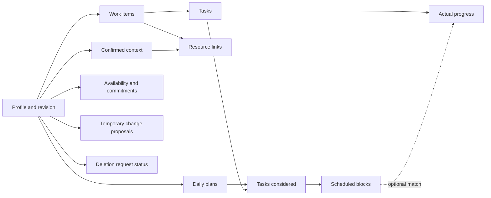

# Trajectory — Database Proposal

> **Status: Task Master Parts 1 and 2 storage are implemented; the cross-phase catalogue remains proposed.** Running.md records migrations 3/4 and verification. Completion controls and creation-based deadlines are implemented; daily proposals remain pending.
> Based on `setup/Product.md` and the approved `setup/Architecture.md`. Approval of architecture does not resolve choices that it labels OPEN DECISION. This document creates no tables, migrations, code, or application files. `setup/Design.md` remains outside this alignment scope.

## 1. Read this first

**Confirmed direction:** SQLite/sqlite3 for a local, single-user Phase 1 app, as approved in Tasks.md. The detailed schema below remains a retained cross-phase proposal, not a current 12-table requirement or an instruction to implement it. Keep ordinary facts in relational tables; reserve validated JSON for temporary proposals and source references.

| Label | Meaning here |
| --- | --- |
| Current product boundary | Implemented goal/checkpoint plans, standalone to-do management, done/undone controls and deadlines; daily proposals remain pending. Legacy detailed progress is preserved but hidden. Calendar windows/blocks, navigator context and forecasting are deferred. Section 3.0 records the original standalone contract, extended by the Part 2 implementation notes below; other catalogue detail remains proposed. |
| Proposed rule | A concrete recommendation that still needs review before implementation. |
| Future | Not required for the initial schema; add only after scope approval. |
| OPEN DECISION | A choice that affects data meaning or delivery and remains unsettled. |

**Legend:** PK = primary key, the unique identity of a row. FK = foreign key, a reference to another row. NN = required/non-null. NULL = absent or unknown, not zero. UNIQUE prevents duplicate values. CHECK limits allowed values. “Service rule” means application code must validate it; a foreign key alone cannot enforce it.

### Retained cross-phase data map



Arrows show the main ownership/reference paths, not every FK. The cross-phase catalogue tables in Sections 3.1-3.12 remain proposals; Section 3.0 separately records the implemented standalone task contract. Personal context supports planning but never supplies authoritative numerical forecasts.

## 2. Shared conventions

- **IDs:** Proposed application-generated UUID strings stored as TEXT PK, NN, immutable and never reused. This avoids deleted IDs being mistaken for old source references. `profile.id` is the single-user exception below.
- **Common columns (all ordinary tables):** `created_at TEXT NN`, `updated_at TEXT NN`, and `version INTEGER NN DEFAULT 1 CHECK >= 1`. These are included in every table below except the two explicitly identified link tables. Update `version` on every correction.
- **Time:** Store instants as canonical UTC ISO-8601 TEXT and calendar dates as `YYYY-MM-DD` TEXT. Store an IANA timezone separately where local-time interpretation matters. Services parse/validate dates and zones; text shape checks do not prove a valid date. No timezone is silently inferred from the server.
- **Quantities:** Proposed progress units are task-specific and quantities are finite nonnegative REAL values. Units, decimal precision, and rounding need approval. Time estimates are integer minutes, separate from completed quantities.
- **Text/status:** Required names must be nonblank after trimming. Status/category values use explicit CHECK lists. Validate lengths and JSON contracts in services; reject non-finite numbers and invalid values before persistence.
- **SQLite enforcement:** Enable and verify foreign keys on every connection; use parameterized queries and short transactions. SQLite has flexible typing, so declared types alone do not establish valid data: validate types and use suitable CHECK constraints. See [foreign-key guidance](https://www.sqlite.org/foreignkeys.html) and [datatype guidance](https://www.sqlite.org/datatype3.html).
- **Ownership:** Each owned row carries `profile_id INTEGER NN FK -> profile.id`, except link/block rows whose owner is derived through their plan. Services enforce the same profile on every linked record. A single-user profile is not authentication or a multi-user security design.
- **FK defaults:** Unless specified otherwise, deletion is RESTRICT and key updates are RESTRICT. RESTRICT blocks deletion until the service has explicitly handled dependents. CASCADE below means deleting owned child rows automatically; it never authorizes deleting a user's data without an explicit action.

## 3. Phased table catalogue

### Current relationships and remaining storage review

Current implementation persists goal plans with checkpoints and goal-linked tasks; legacy detailed progress remains stored but hidden. Standalone task management, saved completion controls and deadlines are implemented for Task Master Parts 1 and 2; daily proposals remain pending Product.md Section 4 work. Section 3.0 specifies the standalone contract and implementation boundary. Tasks need stable identities across days and plans. Completed tasks remain recorded, unfinished tasks remain available and a new plan must not reset status or duplicate tasks. Goal/milestone association is not required for a standalone to-do.

The four allowed deadline choices are owned by Product.md. The task's creation day is the confirmed duration anchor, using local calendar days. Storage must preserve that origin across edits and replanning; it must not silently renew a duration each day. Part 2 stores a fixed local creation date plus a nullable 2/4/7-day duration; the resolved date is calculated from those saved fields. The Part 2 implementation notes below supersede the historical Part 1-only contract where applicable.

Daily allocations are proposals distinct from persistent to-dos and actual progress. Available time does not require recurring windows, calendar integration or scheduled blocks. Decide minimal plan retention/replacement and completion/progress detail against existing storage; no daily-plan table set is approved by this update.

Running.md documents existing proposal JSON, approved snapshots and task membership. Review compatibility with those records before any separately authorized migration. Lightweight checkpoint representation remains open; automatic milestone/checklist management, quantity roll-up, detailed blocker/time logs and forecasts are deferred.

**Catalogue boundary:** Section 3.0 defines the minimum standalone contract used by Part 1. Sections 3.1-3.12 and Sections 4-7 retain earlier schema/lifecycle proposals for reference, not a package to build now; they do not override Section 3.0 for its standalone slice. Reuse relevant existing structures where sufficient. In particular, 3.6's recurring windows and 3.9's time-slot blocks are deferred; 3.7-3.8 are not the selected implementation for the simple daily planner. This documentation change creates no tables or modules.

### 3.0 Task Master: minimum standalone task contract

**Part 1 implementation - October 21, 2026:** The user authorized building the separately planned standalone task-management slice. Section 3.0's task fields, create/edit/removal behavior and additive migration 3 are implemented and verified using temporary databases. During the later authorized local startup, the personal database was backed up and migration 3 was applied; comparison with that backup confirmed all 12 existing data tables were unchanged. This is historical Part 1 evidence; the Part 2 implementation below adds done/undone actions and deadlines.

**Scope and precedence:** This section defines the minimal standalone slice for P1.T1 and the simple status representation needed by P1.T2. It takes precedence over the retained catalogue's proposed task fields, common columns, profile ownership and deletion machinery for this slice only. It does not select that catalogue or the future daily-plan schema. Further Task Master parts require separate implementation authorization.

#### Part 1 user input and stored fields (historical; Part 2 extension below)

The creation/edit form asks only for a title and optional notes. Notes map to `description` in storage. No goal, milestone, effort estimate, priority or deadline is required by P1.T1; the full MVP's four deadline choices remain P1.T3 work with unresolved date semantics.

Use one additive table, `standalone_tasks`, in the existing SQLite database:

| Field | Storage contract | Meaning and authority |
| --- | --- | --- |
| `id` | TEXT primary key, non-null; application-generated UUID string | Immutable task identity, never reused or derived from its title. |
| `title` | TEXT non-null; 1-160 characters after trimming | Required user-entered action. Duplicate titles are allowed; identity is the ID. |
| `description` | TEXT non-null, default empty string; at most 1,200 characters after trimming | Optional user-entered notes. Missing/blank input becomes an empty string, not invented context. |
| `status` | TEXT non-null, default `undone`; allowed values `undone` / `done` | Persistent completion state. P1.T1 creates tasks as undone and does not expose status edits; P1.T2 adds explicit done/undone actions. |
| `revision` | INTEGER non-null, default 1; integer >= 1 | Server-managed optimistic concurrency token; increment on each successful edit or actual status change. |
| `created_at` | TEXT non-null; canonical UTC timestamp | Server-assigned creation instant, preserved through edits and status changes. |
| `updated_at` | TEXT non-null; same UTC timestamp format | Server-assigned latest change instant; initially equal to creation time. |

Use the application's existing UTC timestamp format (`YYYY-MM-DDTHH:MM:SS.sssZ`). These timestamps do not define deadline anchors, a local timezone or planning days. This slice intentionally uses `revision` and empty optional description to match existing application conventions rather than adopting the catalogue's proposed `version` and nullable description.

The task-input contract accepts only `title` and `description`; extra business fields are rejected. Form transport controls such as the CSRF token and expected revision are parsed separately. IDs, status and timestamps cannot be changed through the ordinary edit form. An edit preserves ID, creation time and status; it never creates a replacement task. Server validation and SQLite constraints enforce required text, length bounds, status values and integer revision bounds. Render all user text with escaping.

P1.T2's status action carries the explicit desired state and expected revision, rather than a blind toggle. Marking done retains the row; undoing completion changes the same row back to undone. No daily reset, progress-entry dependency, completion-time history or analytics is introduced. No separate completion timestamp is needed for this contract.

#### Storage compatibility and correction rules

The current `approved_tasks.goal_id` is non-null, and approved snapshots, milestone links and hidden legacy work entries refer to that table. Making its goal optional would affect existing goal-scoped services and history. Use the separate table above for ordinary to-dos and reuse the existing SQLite connection and transaction helpers.

- Do not modify, backfill, copy or relink existing goals, approved task rows, approved snapshots, milestone associations or preserved progress entries.
- No goal/milestone FK, singleton profile, general work-item hierarchy or proposed catalogue table is needed for this local single-user slice.
- Apply a reviewed, versioned additive migration only when implementation is authorized. Register its version in the existing migration mechanism; never recreate the live database or rewrite earlier migrations.
- List stored standalone tasks directly in a deterministic order: newest creation first, then ID for equal timestamps. Editing or day changes do not duplicate or recreate tasks. Later status filtering must retain completed rows.
- For edits, re-read the task and compare the expected revision within a short write transaction. Missing records and stale revisions return explicit feedback without inserting or overwriting anything.
- Failures roll back the entire mutation and preserve saved data. Unsaved form values remain available for correction; an error must not be reported as a successful save.
- Task revisions protect individual edits. Future daily proposals must also detect task additions and removals; the proposal input-set/version policy remains to be defined with P1.T5/P1.T6.

#### Removal behavior

**Delete means permanent removal from the live application database.** There is no archive, trash table, hidden deleted row or automatic expiry in this slice. Completion is separate: done tasks stay saved until the user explicitly deletes them.

1. Start deletion from one identified standalone task. Show its title and whether it is done or undone, state that deletion is permanent, and require explicit confirmation. Cancel changes nothing; no bulk deletion is included.
2. The confirmed mutation carries the task ID and expected revision and uses the application's CSRF protection. A read-only request or visiting the confirmation page cannot delete anything.
3. In a short write transaction, re-read the record, check its revision and check for dependent records. A concurrent edit/status change rejects deletion and requires a fresh review.
4. P1.T1/P1.T2 tasks have no dependent records. Delete the row physically and commit. A repeated request for an already absent ID reports that it is already absent and deletes nothing else; it never recreates a record.
5. On database or dependency-check failure, roll back and report that deletion did not complete. Do not leave a hidden partially deleted record or claim success.
6. Existing goal-linked tasks are outside this action. Never cascade from a standalone deletion into goals, milestones, approved plans or legacy progress.

**Future dependency gate:** Before daily proposals or other records can reference standalone tasks, extend this removal contract in the same reviewed scope. Until affected records can be previewed and dependent copies/references can be handled atomically, reject deletion of a referenced task with an explanation. Do not silently cascade, retain deleted text in proposal/snapshot payloads, or treat unlinking as content removal. Daily proposal/history cleanup and retention remain open; this contract selects no historical-plan deletion policy.

This is live-data deletion, not a promise about forensic erasure or backup expiry. Do not add raw task content to logs, audit copies or deletion manifests. The catalogue's later profile-wide deletion requests and summary cleanup are not prerequisites for deleting an independent row.

#### Verification required when implementation is authorized

Verify create/list/edit with title-only and optional notes; whitespace and length validation; rejection of extra fields; distinct identities for equal titles; persisted metadata across restart; stale edits; transaction rollback; and preservation of existing goal-plan/progress records after the additive migration.

Verify confirmed/cancelled deletion, CSRF and mutation-method protection, stale deletion, repeated deletion, rollback and the absence of retained task content in live storage. P1.T2 additionally verifies done/undone persistence across restart and day changes, status preservation through ordinary edits, and no reset or task duplication. Referenced-task deletion cases become required when dependencies are introduced.

Part 1 verification passed 39 new regression cases and all 138 tests in the full suite. Additive migration and failure tests used temporary databases. This was the Part 1 result. Part 2 adds P1.T2/P1.T3; P1.T4-P1.T7 remain unimplemented. See Running.md for browser checks and implementation limits.

### A. Personal trajectory and organized work

#### 3.1 `profile` — local owner and stale-data protection

| Column | Type / constraints | Purpose |
| --- | --- | --- |
| `id` | INTEGER PK, CHECK = 1 | Exactly one local profile at most; initialize it before other records. |
| `timezone` | TEXT NN | User-confirmed IANA timezone. |
| `data_revision` | INTEGER NN DEFAULT 1, CHECK >= 1 | Increment on every authoritative data change, including corrections/deletions. |
| Common columns | As Section 2 | Edit/version metadata. |

No account, password, or email fields are proposed. Before public multi-user access, redesign identity, ownership constraints and authorization rather than adding login around this singleton.

#### 3.2 `work_items` — goals, courses, and projects

| Column | Type / constraints | Purpose |
| --- | --- | --- |
| `id`, `profile_id` | PK and owner FK | Identity and ownership. |
| `kind` | TEXT NN; goal / course / project | Category, not three competing implementations. |
| `title` | TEXT NN, nonblank | Human-readable name. |
| `description` | TEXT NULL | User-confirmed details or ambitions. |
| `deadline_at` | TEXT NULL | Confirmed deadline instant; unknown remains NULL. |
| `priority` | TEXT NN; high / medium / low / unset | User-defined priority; unset is not a model guess. |
| `status` | TEXT NN; active / paused / completed / archived | Organization state. |
| Common columns | As Section 2 | Correction metadata. |

No general nested project hierarchy or learning-roadmap graph is required now. Goal checkpoints provide structure without requiring automatic milestone management. Course categories and career-interest context below remain deferred catalogue ideas.

#### 3.3 `tasks` — actionable workload

| Column | Type / constraints | Purpose |
| --- | --- | --- |
| `id`, `profile_id` | PK and owner FK | Identity and ownership. |
| `work_item_id` | TEXT NULL FK -> work_items.id, RESTRICT | Optional parent; standalone tasks are allowed. |
| `title`, `description` | TEXT NN nonblank; TEXT NULL | Action and optional explanation. |
| `deadline_at` | TEXT NULL | Task-specific deadline. |
| `priority` | TEXT NN; high / medium / low / unset | Explicit scheduling preference. |
| `status` | TEXT NN; active / paused / completed / archived | Task state, not inferred from time spent. |
| `progress_unit` | TEXT NULL | Such as lesson, exercise, or page; required when quantities are recorded. |
| `remaining_quantity` | REAL NULL, CHECK >= 0 | User-confirmed remaining workload in that unit. |
| `remaining_effort_minutes` | INTEGER NULL, CHECK >= 0 | Separate current scheduling estimate. |
| Common columns | As Section 2 | Revision and corrections. |

Deferred catalogue service rules (not current to-do prerequisites): require `progress_unit` when remaining quantity is present. No implicit conversion between pages, lessons, and minutes. Unknown effort is NULL and triggers clarification before scheduling; zero effort is not unknown. Proposed deadline policy: use the earlier applicable parent/task deadline, flag conflicts, and never silently move one. This policy requires approval.

Changing a task's unit after progress exists requires an explicit reviewed conversion or reset of affected quantities/history; never relabel existing measurements. Do not automatically subtract time spent from remaining quantity. Until a progress-update policy is approved, save completed quantity and any revised remaining quantity as distinct user-confirmed inputs in one transaction.

#### 3.4 `context_records` — confirmed interests, preferences, decisions, detours, summaries

| Column | Type / constraints | Purpose |
| --- | --- | --- |
| `id`, `profile_id` | PK and owner FK | Identity and ownership. |
| `kind` | TEXT NN; interest / preference / decision / detour / summary | Compact typed context; no full-chat archive. |
| `title`, `body` | TEXT NN nonblank, both | Inspectable user-confirmed content. |
| `reason` | TEXT NULL | Required by service for decisions and detours. |
| `work_item_id` | TEXT NULL FK -> work_items.id, RESTRICT | Optional related goal/course/project. |
| `related_context_id` | TEXT NULL FK -> context_records.id, RESTRICT | Optional interest or decision being discussed; prohibit self-links and cycles in service. |
| `priority` | TEXT NN; high / medium / low / unset | Current learning interest emphasis, not an inferred ranking. |
| `status` | TEXT NN; active / paused / superseded / archived | Current versus historical relevance. |
| `starts_on`, `ends_on`, `review_on` | TEXT NULL, each | Detour dates where applicable; service checks end >= start. |
| `confirmed_at` | TEXT NN | When the user approved this exact content. |
| `source_manifest` | TEXT NULL, validated JSON list | Derived summary's typed source IDs and versions; see Section 6. |
| `source_revision` | INTEGER NULL, CHECK >= 1 | Revision of inputs used for a summary. |
| Common columns | As Section 2 | Correction metadata. |

Conditional rules: summary records require a source manifest and source revision. Ordinary manually entered interests/preferences need neither. Detour date fields apply only to detours. Expiry/review prompts do not automatically supersede goals or commitments. A superseded decision remains historical evidence, never an active instruction.

This shared table reduces one-table-per-context-type overhead. The trade-off is explicit kind-dependent validation. If that logic becomes difficult, split tables through a reviewed migration rather than adding loosely defined fields. AI suggestions remain in proposals until confirmed.

#### 3.5 `resources` — courses, playlists, and other references

| Column | Type / constraints | Purpose |
| --- | --- | --- |
| `id`, `profile_id` | PK and owner FK | Identity and ownership. |
| `title` | TEXT NN nonblank | Resource label. |
| `kind` | TEXT NN; course / playlist / article / other | Simple resource category. |
| `url` | TEXT NULL | Optional validated http/https link; storage does not authorize fetching. |
| `notes` | TEXT NULL | User-entered context. |
| `work_item_id` | TEXT NULL FK -> work_items.id, RESTRICT | Optional related work. |
| `context_record_id` | TEXT NULL FK -> context_records.id, RESTRICT | Optional related interest/decision. |
| Common columns | As Section 2 | Correction metadata. |

Either, both, or neither relationship may be present. Proposed catalogue limit: one work link and one context link per resource; many-to-many resource tagging is future scope. A course work item tracks workload; its resource link identifies learning material, avoiding duplicate progress totals.

### B. Capacity, plans, and actual work

Sections 3.6-3.9 retain deferred interval-scheduling proposals. Current daily planning needs only user-supplied available time and proposed task allocations; it does not approve these tables. Section 3.10's richer measurements remain proposed: current completion/progress recording must not require invented minutes or quantities. Context records in 3.4 and navigator resource use in 3.5 remain deferred.

#### 3.6 `time_windows` — availability and reserved commitments

| Column | Type / constraints | Purpose |
| --- | --- | --- |
| `id`, `profile_id` | PK and owner FK | Identity and ownership. |
| `kind` | TEXT NN; available / commitment | Gross usable interval or reserved busy interval. |
| `title` | TEXT NN nonblank | Availability/commitment label. |
| `pattern` | TEXT NN; once / weekly | Proposed minimal recurrence vocabulary. |
| `timezone` | TEXT NN | Zone for interpreting this window. |
| `local_date` | TEXT NULL | Required only for a one-off window. |
| `weekday` | INTEGER NULL, CHECK 0..6 | Required only for weekly windows; Monday = 0. |
| `local_start`, `local_end` | TEXT NN, each | Validated HH:MM local times. |
| `valid_from`, `valid_until` | TEXT NULL, each | Inclusive weekly-rule date bounds; service checks ordering. |
| `status` | TEXT NN; active / archived | Whether used in planning. |
| Common columns | As Section 2 | Correction metadata. |

DB/service rules: exactly the fields for the chosen pattern; end > start. Deferred interval-scheduling proposal represents overnight windows as two dated/rule intervals and does not add a general recurrence engine. DST-ambiguous/nonexistent local times require an approved policy or clarification, not silent server conversion. Exceptions use edits/split date ranges until a richer recurrence scheme is approved.

Calculate capacity from the union of availability intervals minus the union of commitments. Overlapping availability must not double-count time, and a commitment outside availability must not create negative capacity. Store rules; derive concrete occurrences for the selected planning horizon rather than duplicating them as authoritative rows.

#### 3.7 `plans` — draft, accepted, and superseded daily plans

| Column | Type / constraints | Purpose |
| --- | --- | --- |
| `id`, `profile_id` | PK and owner FK | Identity and ownership. |
| `plan_date`, `timezone` | TEXT NN, each | Local planning day and its zone. |
| `status` | TEXT NN; draft / accepted / superseded / invalidated | Explicit lifecycle. |
| `source_revision` | INTEGER NN, CHECK >= 1 | Profile revision used when this plan was proposed. |
| `accepted_at` | TEXT NULL | Required for accepted/superseded plans; retained if later invalidated. |
| `acceptance_key` | TEXT NULL UNIQUE | Server-issued idempotency token; required after acceptance. |
| Common columns | As Section 2 | Draft corrections/version. |

A new day creates a separate daily plan referencing existing persistent tasks; it does not reset task/milestone progress or copy unfinished master tasks. Preserve historical planned allocations and independently recorded contributions. Next-day proposals use remaining work, blockers, changed deadlines and available capacity; replacement still requires approval. Detailed carry-forward and minimum-session rules remain open.

At most one accepted plan per `(profile_id, plan_date)` via a proposed unique partial index on accepted rows. A replacement atomically supersedes the old accepted row and accepts the new one. Never mutate historical accepted blocks as if the original plan had been different. Accepted plans may later be invalidated by deletion; retain acceptance metadata without making them current again.

#### 3.8 `plan_tasks` — every task considered, including unscheduled work

| Column | Type / constraints | Purpose |
| --- | --- | --- |
| `plan_id` | TEXT NN FK -> plans.id, CASCADE | Owning plan. |
| `task_id` | TEXT NN FK -> tasks.id, RESTRICT | Task considered. |
| `requested_minutes` | INTEGER NN, CHECK > 0 | Requested allocation for this day, not necessarily all remaining effort. |
| `unallocated_reason` | TEXT NULL | Explanation if some requested time cannot fit. |
| Primary key | Composite `(plan_id, task_id)` | One allocation summary per task per plan. |

This link table has no common columns: its plan owns versioning and timestamps. Unallocated minutes = requested minutes minus its scheduled block minutes; calculate rather than store a second total. Every task explicitly submitted for planning must appear, so the model cannot hide overload by omitting it. Report work not selected for today separately; it is not automatically today's capacity shortfall.

#### 3.9 `plan_blocks` — scheduled work intervals

| Column | Type / constraints | Purpose |
| --- | --- | --- |
| `id` | TEXT PK NN | Stable block identity. |
| `plan_id`, `task_id` | TEXT NN, both | Composite FK -> plan_tasks(plan_id, task_id), CASCADE. |
| `starts_at`, `ends_at` | TEXT NN, each | UTC instants, end > start. |

No common columns: the owning plan controls edits and versioning. Multiple blocks may schedule one task. Services validate same planning day, minute precision, positive duration, membership in availability, no commitment conflicts, no overlap across blocks, and allocated total <= requested minutes. Cross-row overlap/capacity validation belongs in the acceptance transaction, not a row-level CHECK. Preserve the old accepted plan if any check fails.

#### 3.10 `progress_entries` — what actually happened

| Column | Type / constraints | Purpose |
| --- | --- | --- |
| `id`, `profile_id` | PK and owner FK | Identity and ownership. |
| `task_id` | TEXT NN FK -> tasks.id, RESTRICT | Work performed, scheduled or not. |
| `plan_block_id` | TEXT NULL FK -> plan_blocks.id, SET NULL | Optional match to planned work. |
| `occurred_at` | TEXT NN | When work occurred. |
| `minutes_spent` | INTEGER NN, CHECK >= 0 | Actual time; zero allowed for a quantity-only update. |
| `completed_quantity` | REAL NULL, CHECK >= 0 | Work completed in the task's confirmed unit. |
| `notes` | TEXT NULL | Optional user-entered observation. |
| Common columns | As Section 2 | Correctable measurement, not an immutable audit event. |

Proposed measurement rule: require positive minutes or positive completed quantity; reject empty entries. **OPEN GAP:** This rule alone cannot represent a blocker-only, completion-only or notes-only contribution. Review that distinction before actual-work implementation; it must not force invented time/quantity or discard those required records. Service verifies that an optional block belongs to this task/profile. Unit changes are restricted as in Section 3.3. Logging an unscheduled task is valid. Deleting a plan removes the optional association, not the independently recorded actual work.

Deferred forecasts are Phase 2 derived results, not authoritative database rows in this proposal. Calculate from validated progress, remaining workload, and explicit future-capacity assumptions; expose the formula/version and missing data in the result. Do not sum incompatible task units into a goal total. Goal roll-up and rate estimation remain OPEN DECISION; without comparable evidence return an unavailable estimate. Historical forecast snapshots can be added later if approved.

### C. Approval and deletion lifecycle

#### 3.11 `change_proposals` — inspectable drafts, never saved facts

| Column | Type / constraints | Purpose |
| --- | --- | --- |
| `id`, `profile_id` | PK and owner FK | Identity and ownership. |
| `kind` | TEXT NN; goal_entry / trajectory_change / detour | Bounded confirmation workflow. Daily plan drafts use plans/plan_tasks/plan_blocks. |
| `payload` | TEXT NULL, schema-validated JSON | Proposed exact values and target/source versions; required while pending. |
| `source_manifest` | TEXT NULL, validated JSON | Typed input record IDs/versions, not a transcript. |
| `source_revision` | INTEGER NN, CHECK >= 1 | Revision used for the proposal. |
| `status` | TEXT NN; pending / applied / rejected / invalidated / expired | Only pending proposals may be applied. |
| `expires_at` | TEXT NN | Bounded retention; duration OPEN DECISION. |
| `resolved_at` | TEXT NULL | Resolution time. |
| Common columns | As Section 2 | Edited proposals require review of the new version. |

Approval checks the exact displayed proposal version and current profile revision. Apply all validated changes and resolve the proposal in one transaction, then increment the profile revision. A retry of an applied proposal returns its resolved status, not a second mutation. Clear personal payload/source content on resolution or expiry unless an approved retention policy explicitly requires it. Confirmed facts belong in normal tables, not hidden JSON memory. Do not store raw prompts, full chat, or malformed model responses by default.

#### 3.12 `deletion_requests` — honest cleanup status

| Column | Type / constraints | Purpose |
| --- | --- | --- |
| `id`, `profile_id` | PK and owner FK | Request identity and ownership. |
| `status` | TEXT NN; pending / completed / failed | Failed cleanup remains unresolved; allow a controlled retry. |
| `target_manifest` | TEXT NULL, validated JSON | Pending target types/IDs; no copied personal content. Clear on completion. |
| `completed_at` | TEXT NULL | Required for completed requests. |
| `failure_code` | TEXT NULL | Safe operational category, not source text or secrets. |
| Common columns | As Section 2 | Request timing/version. |

No FK is possible from this typed target list to multiple tables. Services verify every target and block its use while pending/failed. For small local deletes, aim to complete cleanup in a single transaction; a durable pending request supports retry if cleanup is interrupted. Completed status means the defined live-data cleanup finished, not proven erasure from disks, backups, or external providers.

## 4. Relationships and integrity at a glance

| Relationship | Cardinality | On parent deletion |
| --- | --- | --- |
| Profile -> owned records | One to many | RESTRICT; full reset is a separately confirmed coordinated action. |
| Work item -> tasks/context/resources | One to many, optional parent on child | RESTRICT; show choices and handle dependents explicitly. |
| Context -> related context/resources | One to many, optional links | RESTRICT; unlink or delete chosen dependents first. |
| Plan -> plan_tasks -> blocks | One to many -> one to many | CASCADE owned plan detail. |
| Task -> plan_tasks/progress | One to many | RESTRICT until dependent records are explicitly handled. |
| Block -> progress | One to many, optional association | SET NULL, preserving actual-work measurements. |

Important checks outside simple FKs: same-profile ownership; conditional context/recurrence fields; valid date/timezones; source-manifest integrity; confirmation of important changes; valid state transitions; stale revisions; task/block agreement; and schedule overlap/capacity. Repository methods enforce these through services and transactions, not browser checks alone.

## 5. Corrections, archiving, and deletion

### Correction: replace the current fact, invalidate derived advice

```text
Review exact change -> confirm when required -> check row version
    -> validate -> update + increment row/profile revisions
    -> invalidate affected drafts/derived context -> commit -> recalculate
```

Proposed conservative policy for the later shared-profile catalogue (not an assertion about current implementation): any authoritative change invalidates all pending AI proposals and draft plans for this profile, and marks all summaries stale. This may request unnecessary regeneration but avoids a complex dependency engine. Do not treat a summary as current unless its source revision still matches. When confirming a new or corrected summary, validate its input revision first, invalidate older derived records, then stamp that summary with the resulting committed profile revision so its own save does not immediately make it stale. Accepted schedules remain historical records; revalidate their feasibility when inputs change and require explicit approval for a replacement. Source references must also be rechecked before returning in-flight advice.

Correcting progress updates that row rather than storing a hidden copy of the incorrect observation; recalculate forecasts. Do not overwrite accepted schedule history to match actual work. Important goal/commitment changes require confirmation; exact boundaries remain OPEN DECISION. Archiving retains information and is not deletion; archived facts must not be selected as current priorities.

### Deletion: remove content and its derived copies

1. Show affected records before confirmation, including actual-progress history and plans that would be lost or invalidated. Do not silently cascade through a whole goal.
2. Record pending targets and increment the profile revision. Exclude targets from new retrieval, acceptance, and advice immediately; reject results already in flight against older revisions.
3. In a short transaction, handle FK dependents and remove selected live records. Purge pending proposal payloads and all derived summaries conservatively; inspect and remove source-dependent text in context/resource notes and accepted plans as needed. Mere unlinking does not remove copied personal text.
4. Clear the request manifest and mark completed only after required cleanup succeeds. On failure keep targets excluded and provide retry/status feedback. Do not report successful deletion just because a source row disappeared.

| Deletion target | Proposed handling requiring an explicit preview/choice |
| --- | --- |
| Work item | Reassign/unlink surviving tasks, resources and context, or explicitly delete selected children. Never silently delete actual work. |
| Task | Show affected progress and plans. Explicit task-history deletion removes progress and its plan-task links/blocks; invalidate affected plans so they are not presented as intact schedules. Alternatively archive the task to retain history. |
| Plan | Delete plan details; progress survives with block reference NULL. Any copied deleted-source text must also be purged. |
| Context/resource | Remove direct content and dependent copies/summaries. Unlink or explicitly delete related records after preview. Removing a detour does not authorize a goal change. |
| Progress entry | Remove the measurement, increment revisions, and recalculate remaining-work assumptions/forecasts with user review where needed. |

**OPEN DECISION:** Finalize retention, backup expiry, externally processed data, and whether deletion must include selected historical plan details. Do not promise forensic erasure. User deletion controls must not be implemented as indefinite soft-delete storage. Logs should contain operational metadata, not an alternate personal-content archive.

## 6. Sources, confirmations, and version checks

Source manifests are JSON lists of `{record_type, record_id, version}` with an allowlisted type and an existing same-profile record. They are for summary/proposal provenance only, not SQL joins or a second source of goals and progress. Unlike a real FK, the database cannot enforce these references: services validate them on save/use and invalidate them on correction/deletion. This retained catalogue trade-off avoids a table per source type; reconsider typed relationship tables if provenance needs grow.

User-approved structured records are saved facts about stated preferences and recorded work; model interpretations remain labeled suggestions. A reference proves a record exists, not that advice correctly interprets it. RAG, embeddings, a vector database, and stored full conversations are not prerequisites.

Acceptance sequence: begin a short write transaction, re-read the profile revision and proposal/plan version, validate current references and constraints, write the approved change, increment `data_revision`, then commit. No model call occurs inside it. Simultaneous or repeated requests must be checked again after serialization; mismatch yields a review prompt, not an overwrite. Draft/proposal edits alone update their row/plan version, not the authoritative profile revision. Accepting a plan increments the authoritative revision and invalidates other stale drafts. Its stored source revision remains a historical input marker, not a claim that it stays current forever.

## 7. Indexes, durability, and verification

| Proposed index/check | Why it exists |
| --- | --- |
| Every FK child column, including composite plan/task references | Efficient dependent lookups and cleanup. |
| tasks(work_item_id, status), progress_entries(task_id, occurred_at) | Work views and evidence-based progress history. |
| context_records(profile_id, kind, status) | Bounded current trajectory selection. |
| time_windows(profile_id, kind, status) | Availability/commitment selection. |
| plans(profile_id, plan_date, status) | Retrieve daily draft/current/history. |
| Unique accepted plan per profile/date; unique non-null acceptance_key | One current plan and idempotent acceptance. |
| change_proposals(profile_id, status), deletion_requests(profile_id, status) | Pending approvals, exclusion and cleanup recovery. |

Use SQLite's [partial unique indexes](https://www.sqlite.org/partialindex.html) for accepted-plan uniqueness if the supported version permits; test the selected SQLite version. Avoid indexing every free-text column or adding full-text/vector search without evidence.

Ordered, reviewed migrations should track a schema version and preserve user data; migration tooling remains OPEN DECISION. Test upgrades against a temporary copy before a real database, and never silently recreate it on startup. Store the live file on durable local/host-supported storage outside static files and Git. Backup policy and restore behavior need approval; restored data must honor completed deletion requests rather than silently resurrect removed content.

Later tests must cover FK enforcement per connection, invalid values/relationships, atomic rollback, version conflicts, duplicate acceptance, one accepted plan/date, restart persistence, progress correction, capacity union, and source/deletion invalidation. No executable schema, migrations, tests, or database were created or run for this proposal.

## 8. Phase boundaries and future data

| Data by phase; detailed schema still proposed | Future only; no tables proposed now |
| --- | --- |
| Current product: goal/checkpoint plans and standalone task management implemented; daily proposals still pending contract review | External calendar sync and rich recurrence/exceptions |
| Deferred Phase 2: recurring time rules and scheduled blocks, broader commitments and advanced forecasting | Multi-day roadmap graphs and historical forecast snapshots |
| Phase 3: multiple interests, preferences, confirmed decisions/detours and approved summaries | Broad conversation/note retrieval and embedding indexes |
| Temporary exact-change proposals and deletion status | Collaboration, accounts, permissions and multiple users |
| Validated progress and remaining effort | Phase 4 Sketch Journal; media/storage/privacy and vision-model decisions explicitly open (Product.md Section 6) |

No persistent “distraction score” or automatic career-path classification is proposed. Alignment advice is a contextual interpretation, not an authoritative user attribute.

## 9. Decisions needed before implementation

| OPEN DECISION | Recommendation to review |
| --- | --- |
| Later deployment | Local single-user scope is confirmed; the singleton profile remains a schema proposal. Hosted multi-user access needs revised ownership/authentication approval. |
| Current relationships | Section 3.0's standalone table and initial undone status are implemented for Part 1. Part 2 status controls and deadlines are implemented; daily-plan relationships remain pending. Existing goal/checkpoint storage is preserved; daily-proposal relationships remain open. No automatic milestone management or full catalogue is selected. |
| To-do deadlines | Local calendar-day measurement is confirmed. The duration starts on the day the task is added (confirmed October 21, 2026). Part 2 uses the computer-local creation date plus nullable 2/4/7-day duration, an inclusive due date and overdue display on unfinished tasks the following day; explicit edits retain the original creation day. |
| Current completion | Section 3.0 specifies persistent done/undone with explicit desired-state changes for P1.T2, without detailed work entries. Implemented by Part 2. Rich measurement units, forecast evidence and milestone roll-up are deferred. |
| Deferred time semantics | Weekly/one-off recurrence, midnight splitting, DST scheduling policy and parent/task deadline precedence are not current prerequisites. |
| Plan lifecycle | Review goal-plan acceptance plus daily-proposal retention/replacement, stable task references and recorded progress. One accepted plan/date remains a proposal, not a selected rule. Dependency/minimum-session policies are deferred. |
| Context structure | Typed shared context table; approve important-change boundaries, summary provenance and review-date behavior. |
| Retention/deletion | Section 3.0 defines confirmed permanent removal for independent standalone tasks and blocks referenced-task deletion until dependency cleanup is reviewed and implemented. Proposal expiry, historical-record cleanup, backup expiry and external-provider handling remain open. |
| Persistence setup | Confirm SQLite on the actual deployment storage, supported version, migrations and durable backup/restore process. |

Technical references checked on 2026-10-18. Exact SQL constraints and dependency versions must be verified during implementation. This document proposes data responsibilities; visual design, routes, model selection, forecast formulas and challenge compliance remain governed by their respective approved or pending documents.

## Task Master Part 2 implementation - October 21, 2026

This authorized slice supersedes the historical Part 1-only status/deadline statements in Section 3.0. Migration 4 transactionally rebuilds only `standalone_tasks` with its original columns/constraints and two additional fields: `created_on` (required valid ISO calendar date) and `deadline_days` (nullable integer restricted to 2, 4 or 7). No dependent tables refer to standalone tasks in Parts 1 and 2. Future references require a new reviewed migration/deletion policy.

Creation captures the UTC instant and local calendar date from the same reading of the computer's clock. The original local date is immutable in application workflows. Existing rows retain every original value; migration derives their local day from `created_at` in the computer's timezone at upgrade and assigns no deadline. The original timezone was not stored in Part 1. The due date is derived as `created_on + deadline_days`, avoiding a second mutable copy. It remains valid through the end of that calendar day; only unfinished work is labelled overdue on following days.

The ordinary input model now additionally accepts `deadline` with exact string values `none`, `2`, `4` or `7`. Omitted deadline on an edit preserves the saved choice. An explicit choice change uses the original creation date, including when that produces an already overdue date. Status remains separate: explicit desired-state POSTs serialize and check the expected revision; actual state changes increment revision, while a fresh no-op does not write. Completion preserves the task, notes, creation day and deadline. Failures roll back, and stale edits/deletions/status requests cannot replace newer work.

The computer-local source, inclusive due date and overdue label are Part 2 implementation defaults presented for review, rather than a new hosted-user timezone policy. Daily-plan persistence, inference, retention and task-reference cleanup remain unimplemented Parts 3 and 4.
