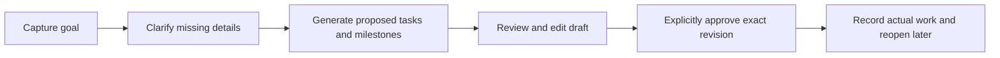

# Trajectory — Design Foundation

> **Status: Design rulebook draft for review.** Documentation only; no UI, assets, CSS, JavaScript, backend or dependencies are created by this document.
> The latest design request authorizes this **root-level `Design.md`**, replacing the earlier deferral for this task. Existing setup documents still reference `setup/Design.md`; those files remain untouched. Numerical tokens and composition recommendations below are proposed baselines, not a tested interface.

## 1. Purpose and design philosophy

Trajectory is a personal workspace for turning ambitions into reviewable plans and learning from actual progress. Its identity should support both focused work today and an evolving, multi-interest career direction over time.

**User-specified foundation:** Predominantly black and white, light working surfaces, readable non-pixel typography, Lucide icons, editorial restraint, subtle organic details and a quiet retro-futuristic atmosphere. Express the atmosphere through composition, typography and occasional line art; never through cryptic labels, hidden actions or reduced readability.

The approved roadmap in [setup/Tasks.md](setup/Tasks.md) governs release allocation. Phase 1 is the Goal-to-Plan Assistant. [setup/Product.md](setup/Product.md) preserves the full vision; architecture, data and AI constraints remain with [Architecture](setup/Architecture.md), [Database](setup/Database.md) and [AI Integration](setup/AI_Integration.md). This rulebook does not settle model, schema or forecast decisions.

| Design intention | Concrete rule | Avoid |
| --- | --- | --- |
| Editorial clarity | One clear heading, purposeful sections and readable task lists. | A wall of equal-weight metric tiles. |
| Calm concentration | White/near-white working canvas; limit prominent actions to the next meaningful step. | Multiple filled primary buttons competing within one task area. |
| Distinctive restraint | Use contrast, aligned labels and occasional organic detail at the edge of content. | Generic rainbow dashboards, arbitrary badges and decorative widgets. |
| User agency | Make draft, accepted, saved and actual-work states explicit. | AI proposals that look confirmed or auto-applied. |
| Long-term coherence | Reuse the foundation for later planning, navigator and journal features. | Building later-phase navigation or empty feature panels in Phase 1. |

**Reference inventory:** Workspace inspection found setup documents, Git metadata and `.gitattributes`, but no application code or visual-reference image assets. The written request is the current visual reference. Any later image references must be reviewed before overriding these rules; no unseen reference has been interpreted.

## 2. Visual identity and design principles

- Keep the main workspace bright, ordered and content-led. An optional dark welcome/entry treatment may be more atmospheric, but must lead directly to useful work; it is not a required extra page, login flow or onboarding sequence.
- Use strong alignment and a simple reading order. Let titles, text and task structure establish hierarchy before adding borders or decorative containers.
- Keep secondary details available through labeled disclosure. Do not hide the current goal, draft status, errors, acceptance action or deletion consequences.
- Prefer precise, supportive language: “Review proposed tasks,” “Record actual work,” “Plan saved.” Do not promise a completion date the application has not calculated or call a detour a distraction.
- Decorative organic marks, if added later, occupy margins/empty-space accents rather than text backgrounds, input fields or primary action areas. No decoration is required to finish Phase 1.

## 3. Color system

**Suggested foundational tokens:** Names are design roles for later centralized implementation, not CSS added now. Neutral values may be adjusted together after contrast review; do not create page-specific substitute palettes.

| Token | Suggested value | Role and restriction |
| --- | --- | --- |
| `canvas` | `#F7F7F5` | Near-white workspace background. |
| `surface` | `#FFFFFF` | Cards, forms and raised content. |
| `surface-subtle` | `#EFEFEB` | Secondary grouping and static hover treatment. |
| `ink` | `#171717` | Primary text, meaningful icons and primary action fill. |
| `ink-muted` | `#595959` | Secondary text, metadata and helper text; not faint placeholder-only labels. |
| `line-subtle` | `#D6D6D0` | Decorative dividers/card boundaries only; not the sole indicator of an input or selected state. |
| `line-control` | `#737373` | Identifiable control boundaries where needed; verify against adjacent surfaces. |
| `inverse-surface` | `#171717` | Optional entry area or deliberately selected dark emphasis. |
| `inverse-ink` | `#FAFAF7` | Text/icons on dark surfaces. |
| `inverse-muted` | `#C7C7C0` | Secondary copy on the inverse surface only. |
| `focus-light` / `focus-dark` | `#171717` / `#FAFAF7` | Visible focus indicator on light/dark surroundings respectively. |

The primary button uses ink fill and inverse text; secondary actions use surface/ink with an identifiable boundary. Selected items need an explicit marker, label or stronger outline, not only a subtle surface change. Links in running text are underlined.

**Status without a new palette:** Use labels such as Draft, Accepted, Completed, Unsaved or Error, with the appropriate Lucide indicator and clear text. Errors get a prominent outline/message and correction guidance; success gets a saved confirmation. No red/green dependency is required. Any future accent needs a specific semantic role and contrast verification; do not assign each goal or component an arbitrary color.

## 4. Typography

**No pixel fonts or pixel-style typography anywhere in the interface.** Pixel-art-inspired illustration, if later approved, is a separate asset choice and cannot determine text rendering.

**Proposed default:** A system sans-serif stack (`system-ui`, Segoe UI, sans-serif) keeps Windows readable without font downloads or another dependency. Use regular weight for prose, medium for labels, and semibold for headings/actions. A non-pixel editorial serif may be evaluated for a small number of display headings later; no decorative family is selected now.

| Role | Suggested size / line height | Use |
| --- | --- | --- |
| Display | 32–40 px / 1.15–1.25 | Optional entry heading; reduce to 28–32 px on narrow screens. |
| Main heading | 28 px / 1.25 | Current workspace/goal heading. |
| Section heading | 20–22 px / 1.3 | Major work sections. |
| Card title | 16–18 px / 1.4 | Task/goal title, allowed to wrap. |
| Body and inputs | 16 px / 1.5 | Descriptions, editable text and instructions. |
| Labels and metadata | 14 px / 1.45 | Short labels and supplementary detail; not the only location for essential instructions. |

Use rem-based equivalents in later implementation so user text settings scale. Aim for 55–75 characters per line in longer prose. Use sentence case; reserve uppercase for rare short metadata, not navigation or paragraphs. Do not truncate essential task titles or render labels as images. Align numerical summaries consistently without suggesting false precision.

## 5. Shapes, surfaces and depth

- Use clean rectangular surfaces with moderate radii: proposed 8 px for controls, 12 px for cards, 16 px for an occasional larger panel. Avoid pill-shaped everything; status labels may be compact but readable.
- Use a 1 px border for ordinary separation and a stronger boundary when state/control identification requires it. Prefer layout/spacing over stacked outlines.
- Default shadow: none. Proposed raised-panel shadow: `0 4px 16px rgba(0,0,0,0.06)`, only where actual overlap needs separation. This is a token suggestion, not a contrast cue or implemented effect.
- Limit nesting to a goal/work group and its task/checkpoint content where possible. Do not wrap every label in another card. An expandable section is useful only when it reduces visible secondary detail.
- Avoid glassmorphism, background blur, gradients, heavy shadows and large decorative rounding. Hand-drawn borders/marks, if later explored, must not resemble controls or obscure focus/error indicators.

## 6. Iconography and illustrations

**Lucide is the required standard icon system.** Use a consistent outline style; suggested sizes are 16 px for small inline metadata, 20 px for controls and 24 px for section emphasis, with a consistent nominal stroke width of 2. Preserve the icon's view box/proportions rather than stretching it.

- Use a real Lucide asset for add/edit/delete/disclosure/check actions where appropriate. Do not substitute emoji, text glyphs, decorative Unicode or improvised CSS shapes for interface icons. Native semantic controls remain native controls, not hand-built pictograms.
- Prefer visible text beside consequential actions such as approval or deletion. Icon-only buttons need a specific accessible name, a discoverable label where ambiguity remains and the full touch target around the smaller glyph. Tooltip-only naming is insufficient.
- Treat decorative icons as hidden from assistive technology; name the interactive control once. No second icon library without an explicit justified decision.
- The [official Lucide guide](https://lucide.dev/guide/) documents SVG assets and platform options. **Proposed implementation approach:** only the approved icons needed by the Flask/Jinja/browser frontend, through reviewed static SVG assets or a minimal compatible integration. Do not introduce React, a frontend build service or a new package merely for icons. Exact asset delivery/version/attribution review remains open; install/download nothing now.
- Hand-drawn botanical details, monochrome line art or pixel-art-inspired imagery remain future assets. Do not construct illustrations from piles of HTML/CSS shapes. No logo, mascot or illustration is finalized by this document.

## 7. Layout and responsiveness

**Composition proposal, not a fixed screen count:** One focused main work area with a compact goal selector and a contextual detail/review area when needed. Phase 1 can perform capture, draft review and progress in the same coherent workspace; do not require a separate page for each state.

| Constraint | Practical baseline |
| --- | --- |
| Main width | Centered workspace up to about 1200 px; reading/form sections should stay narrower rather than stretch text across it. |
| Gutters | About 24–32 px on wide screens; 16 px on narrow screens. |
| Layout change | Use available space/content fit, not device names; stack by roughly 768 px if the two-area layout no longer fits. This breakpoint is provisional. |
| Reading order | Goal/context -> current work or review -> secondary details; desktop and mobile DOM order must remain understandable. |
| Main action | One prominent action per active step, such as Generate proposal, Approve plan or Save changes. Separate destructive controls. |
| Navigation | Only destinations with real current-phase content. Do not add empty Today/Navigator/Journal destinations to imply future completeness. |
| Small screens | One column, wrapping titles/actions and no fixed-width cards. Do not shrink typography or hide required actions to preserve desktop composition. |

Use a compact labeled goal selector/list, not a mandatory dashboard of large goal tiles. Preserve which goal is selected while editing; warn before discarding unsaved work when switching context. Shared cards, forms and buttons keep their proportions across sections.

Today/schedule and richer progress views are Phase 2 design concerns, using these same tokens and hierarchy when implemented. In Phase 1, show the approved goal work plan and actual-work records without implying it is already a calendar schedule. No fake charts, sample performance metrics or placeholders that look like saved user activity.

## 8. Interaction principles

### Phase 1: goal-to-plan loop

This is the already approved functional loop expressed as design states, not a new page architecture. Store/confirmation semantics follow the application contracts, not visual styling.

| Interaction | Foundation rule |
| --- | --- |
| Create/edit task | Visible labeled action; readable fields with persistent labels; show errors near the field and preserve entered text. Distinguish draft edits from saved task edits. |
| Complete task | Explicit checkbox/control with a visible completion label/state. Keep the title readable and editing available. Do not silently equate completion with recorded time or completed quantity; corrections follow the approved data policy. |
| Delete | Separate from primary actions. Describe affected records before confirmation and offer a clear Cancel. Do not imply deleting a plan automatically deletes independent actual work; do not promise undo unless implemented. |
| Select goal/organize | Selection is explicit and keyboard-operable; show the current goal and task association. Prefer lists/section headings over elaborate card grids or drag-only organization. |
| Expand a card/panel | Labeled disclosure button with expanded state and controlled region. Keep key title/status/actions visible; do not nest interactive controls inside a whole-card button. No essential action is hover-only. |
| Review AI output | Label Proposed/Draft, expose missing questions and supporting context where applicable. Approval is a visible explicit action; generation never looks like an already saved plan. |
| Save/approve | Validate edited values and recheck current data; duplicate activation must not duplicate writes. While pending, show the action/status clearly. Show Saved only on confirmed success. |
| Log actual work | Keep time spent and completed work separately labeled with units. Never display unknown progress as 0% or infer a numerical forecast from model prose. |
| Reopen/error | Reopen persistent saved state, not an assumed browser cache. If a save fails, say Unsaved and preserve entries. A stale revision prompts review; a model failure offers retry/manual work without inventing results. |

**Pending feedback is static in the foundation:** Use text such as “Generating proposal…” or “Saving…” and a stable status region; no animated spinner, shimmering skeleton, progress fiction or sound. Keep access to saved work and readable errors. Never show a percentage for an operation without actual progress evidence.

### Shared control states

| State | Visual and behavioral rule |
| --- | --- |
| Default | Clear label, bounded hit area and readable contrast. |
| Hover | Immediate subtle surface/border change; no lift, animation or layout movement. Not a prerequisite for discovering an action. |
| Active/pressed | Immediate ink/surface change without shifting geometry; do not confuse temporary press with persistent selection. |
| Focus | Visible 2 px outline with about 2 px offset, contrasting with adjacent surfaces; preserve it while focused. Use inverse treatment on dark surroundings. |
| Selected | Persistent label/check/outline as well as surface treatment; expose selection semantically. |
| Disabled | Prevent the action and explain the missing prerequisite nearby. Keep the reason readable; do not dim the entire panel into illegibility. |
| Completed | Check/control state plus text indication; optional restrained strike-through, never strike-through alone or a disappearing row. |
| Error/success | Plain-language message and meaningful indicator; distinguish unsaved failure from a saved record followed by another operation's failure. |

Prefer ordinary clicks/taps and native keyboard operation. Double-click, swipe, drag-and-drop and undocumented shortcuts must never be the only path to an essential action. Use in-flow confirmation/disclosure where practical; if a later design needs a dialog, it must manage focus, provide dismissal and return focus to its trigger.

### Later-phase interaction continuity

- **Phase 2:** Today's plan shows allocated work and unallocated requested work without concealing overload. Progress shows planned versus actual separately. Forecasts show their computed basis and missing-data/uncertainty state; replanning remains a draft until accepted.
- **Phase 3:** Career direction remains editable and multi-interest. Alignment advice asks about intentional exploration; it does not shame or silently change priorities. Show saved facts, interpretations and supporting context distinctly; a detour review date is a review prompt, not automatic expiration of a goal.
- **Phase 4:** Historical retrieval, roadmap changes and the journal reuse readable source/status/confirmation rules. Their detailed screens and gestures need separate design/implementation approval.

## 9. Accessibility and usability

Treat accessibility as a baseline to verify, not an achieved certification. No rendered UI exists yet.

- Target at least **4.5:1** for ordinary text and **3:1** for large text as defined by WCAG; verify actual token combinations in all states. See [W3C text contrast guidance](https://www.w3.org/WAI/WCAG22/Understanding/contrast-minimum.html). Do not use the subtle divider token as secondary text.
- Required control boundaries, meaningful icons and state indicators should achieve **3:1** against adjacent colors; decorative dividers are a separate role. See [non-text contrast guidance](https://www.w3.org/WAI/WCAG22/Understanding/non-text-contrast.html). Color alone never conveys acceptance, error, selection or completion.
- Use semantic headings, lists, forms, buttons, links, checkboxes and labeled disclosures. Placeholders supplement labels; they do not replace them. Provide unit labels and clear error associations.
- All interactive elements must work by keyboard with logical order, visible unobscured focus, native activation behavior and no trap. Retain focus during ordinary saves; move it deliberately for errors/expanded content only when needed and predictably announce changes.
- Use concise status announcements for save/generation outcomes without repeatedly interrupting the user. Keep important errors persistent until resolved/dismissed, not solely in brief toasts.
- **Product target:** 44 × 44 CSS px minimum primary/touch control hit areas, with about 8 px separation where possible; glyphs can be smaller. This is deliberately more generous than WCAG 2.2's 24 × 24 minimum with exceptions, not a misstatement of that criterion. See [W3C target-size guidance](https://www.w3.org/WAI/WCAG22/Understanding/target-size-minimum.html).
- Check text enlargement to 200% and reflow at a 320 CSS px-wide viewport; avoid horizontal scrolling for ordinary content. Later genuine schedule/data visualizations may need an appropriate accessible alternative. See [W3C reflow guidance](https://www.w3.org/WAI/WCAG22/Understanding/reflow.html).
- Never make a tooltip, color change, hover, sound or gesture the sole source of meaning. Respect user high-contrast/forced-colors settings; do not depend on shadows/background images for focus or selection.
- No motion is part of this foundation. Future motion must respect reduced-motion preferences and retain equivalent immediate feedback without animation.

## 10. Tokens and foundational components

Use the color/typography tables above as the single source for those roles. Add only a small shared vocabulary for geometry; values are proposed and may be tuned together after actual layout review.

| Token group | Proposed baseline | Rule |
| --- | --- | --- |
| Spacing | 4, 8, 12, 16, 24, 32, 48 px | 4/8 for close labels; 12/16 for local content; 24/32 for groups; 48 for major breathing space. |
| Radius | 8 / 12 / 16 px | Controls / cards / occasional large panels. |
| Border | 1 px standard; 2 px emphasis/focus | Use subtle or control token according to meaning. |
| Shadow | None; one restrained raised-panel token | Only for genuine depth; no shadow per card state. |
| Icon | 16 / 20 / 24 px; nominal stroke 2 | Match purpose consistently; independent 44 px control hit area. |
| Control geometry | Minimum 44 px target; 12–16 px horizontal padding | Height may grow with text; never clip wrapped labels. |
| Layout | 1200 px main max; 16–32 px gutters | Content fitting and readability take priority over an exact breakpoint. |
| Motion | None in foundation | No animation-library dependency or transition system now. |

| Component family | Shared rules | Phase boundary |
| --- | --- | --- |
| Buttons/links | Primary, secondary and destructive hierarchy; visible focus; consistent states and labels. | Foundation/Phase 1. |
| Inputs/textareas/selectors | Persistent label, helper/error text, units and consistent sizing. | Foundation/Phase 1. |
| Goal/task cards or rows | Shared title/status/action structure, wrapping text and explicit selection/completion. A row is acceptable when a card adds no hierarchy. | Foundation/Phase 1. |
| Proposal/milestone review | Clear draft label, editable content, questions and explicit approval. Milestone data/contract remains pending alignment. | Phase 1; no extra calendar view implied. |
| Progress summary | Legible actual-work records and separate time/quantity. Add denominator/basis only when known. | Simple actuals in Phase 1; planned-versus-actual/forecasts in Phase 2. |
| Expandable panel/status message | Labeled keyboard-accessible disclosure; persistent readable feedback with shared tokens. | Foundation where justified. |
| Daily schedule, trajectory context and journal | Reuse the foundation; do not precreate their components/navigation or invent final layouts here. | Phases 2, 3 and separately approved Phase 4 slices. |

## 11. Deferred enhancements — preserve, do not implement now

| Future possibility | Boundary before introduction |
| --- | --- |
| Animated components, subtle micro-interactions or richer transitions | Explicit approval; purposeful feedback, measured performance, no distracting loops and full reduced-motion behavior. No library installed in advance. |
| Optional sound | Off by default, user-controlled and never essential to status/error feedback. Separate design decision. |
| Botanical/hand-drawn line art, pixel-art-inspired assets or more atmospheric entry treatment | Separate asset/reference review; keep UI text non-pixel and workspace clear. No mandatory welcome detour. |
| Experimental gestures, drag organization or richer shortcuts | Discoverable alternatives and ordinary keyboard/touch access first; do not replace essential visible controls. |
| Sketching/drawing and creative-practice journal | Retained Phase 4 vision; requires separate media/data/design scope, not a Phase 1 widget. |
| Historical RAG, long-term roadmap suggestions and richer detour reviews | Retained roadmap extensions; support inspectable evidence and user confirmation. Their mention does not settle technical implementation. |
| Calendar sync, notifications, richer recurrence, specialized learning tools, historical forecasts, hosting/collaboration | Remain exploratory backlog items from Tasks.md until explicitly selected; no new current navigation or infrastructure. |

## 12. Rules for future UI implementation and review

- Implement only the authorized current-phase slice after design approval; a component catalogue is not permission to build every component. For the 6–9 hour Phase 1 budget, prefer the readable system font, shared primitives and no decorative asset production.
- Keep tokens and reusable templates/components centralized, with page-specific assets separated only when needed. Follow the approved Flask/Jinja/modular browser approach; add no alternate framework or effect library through this design document.
- Preserve the backend boundary: visible controls never replace server validation, exact-version approval, persistence integrity or deterministic constraints/forecasts. Do not invent data or change the schema to suit a visual layout.
- During later authorized UI verification, check the Phase 1 functional loop plus keyboard/focus, screen-reader names/statuses, contrast, 320 px reflow, zoom and touch targets. Also inspect long titles, empty/error/pending/unsaved/completed states. No such rendered checks have been run now.
- Preserve the one-file/change-scope workflow from Rules.md. Report actual verification and verified saved line ranges; stop for approval before implementation or another documentation edit.

### Conflicts and choices still visible

| Item | Resolution or pending choice |
| --- | --- |
| Document location | Latest explicit request selects root-level `Design.md`. Older `setup/Design.md` links remain stale until a separately authorized alignment edit; do not create a duplicate design file. |
| Earlier design deferral | This request explicitly authorizes the foundation now. It does not approve application implementation or detailed later-phase page designs. |
| Broader proposed MVP versus staged roadmap | Use the approved Goal-to-Plan Phase 1 boundary; preserve scheduling, forecasts, navigator and advanced vision in later phases. Source-document alignment remains a separate task. |
| Absent reference images | No image assets were found or supplied for this request. Written direction governs; any later visual reference can refine the draft through review. |
| Exact visual values | Token hex values, sizes/radii, system-font default, optional serif and provisional composition/breakpoint need review against a rendered prototype later. No layout/contrast compliance is claimed. |
| Asset choices | Exact Lucide delivery/version and any later illustration/logo are not selected. No decorative font, sound, motion or accent color is approved here. |
| Phase 1 data/contracts | Ordered plan/milestone representation and related source alignment remain open; design labels cannot settle them. |

Technical accessibility/icon references consulted on 2026-10-19. This rulebook defines intended behavior and appearance; it does not claim an implemented interface, usability validation or accessibility certification.