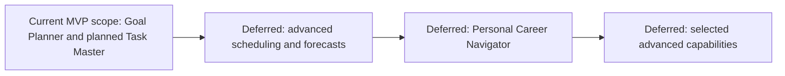

# Trajectory — Phased Implementation Roadmap

> **Status: Roadmap draft for review. No implementation is authorized by this file.**
> Sources: [Product.md](Product.md), [Architecture.md](Architecture.md), [Database.md](Database.md), [AI_Integration.md](AI_Integration.md), [Rules.md](Rules.md), and [DECISIONS.md](DECISIONS.md). Technical proposals and open decisions in those documents remain open.

## 1. Direction and scope

The approved 2026-10-20 scope limits the initial product to **Goal Planner and Task Master** in Product.md Section 4. Preserve implemented goal-plan generation, editing, review, approval and saving. Optional-context changes and hiding legacy progress are implemented and verified in the Goal Planner stabilization milestone. Task Master Parts 1 and 2 implement standalone task management, saved done/undone controls and creation-based deadlines; daily availability and daily AI planning remain pending MVP work. This update aligns the roadmap and recorded evidence; it authorizes no implementation or delivery promise.

| Existing task area | Current release boundary / deferred remainder |
| --- | --- |
| P1.01-P1.08 | Preserve implemented goal/checkpoint proposals and review/approval; preserve genuinely optional context and the hidden legacy progress UI boundary while preserving its code/data. Verify the revised MVP without detailed progress tracking or analytics. |
| P1.T1-P1.T7; former P2.02/P2.03/P2.06 daily subset | Standalone to-do management is complete for Part 1 (P1.T1). Part 2 adds done/undone controls and local-calendar-day deadlines. Daily availability, reviewed AI proposals and planning continuity remain pending. The small Phase 1 steps below own this subset; full Phase 2 tasks remain deferred. Database.md/AI_Integration.md contract alignment requires separate review. |
| Remaining Phase 2 detail | Course/commitment organization, time windows/slots, recurring commitments, dependency scheduling, advanced overload/comparison and forecasts remain deferred. Existing task IDs/dependencies describe that broader future package, not initial prerequisites. |
| Phases 3-4 and backlog | Navigator, retrieval, roadmaps, Sketch AI/Journal, calendar integration, bulk course imports, complex course management, automatic milestone management and autonomous agents remain retained vision, not current work. |

Preserve existing task IDs. P1.T1-P1.T7 separate the planned MVP subset from the broader P2.02/P2.03/P2.06 future package; do not implement it twice or mark the full Phase 2 rows complete when this subset ships. Review dependencies for each small step; forecasts, recurrence and goal/milestone links are not prerequisites for Task Master.

The “eight weeks” in the example goal is user input to clarify, not a project delivery deadline or a guaranteed learning outcome. No calendar schedule or phase-duration promise is made here.

## 2. Tracking and a sustainable working rhythm

| Task status | Use it when |
| --- | --- |
| Not Started | No implementation work/evidence is recorded for the stated scope. Dependencies may still be pending. |
| Partly Implemented | Existing behavior has evidence, but the row names pending changes or unresolved verification; identify both. |
| In Progress | The user has authorized this scope and work has actually begun. Keep only one implementation task active. |
| Blocked | Work cannot proceed; record the specific missing approval, information or technical prerequisite. |
| Complete | Completion criteria have verified evidence and the result has been reported for user review. Completion does not authorize the next task. |

**Implementation evidence and pending work:** Running.md, Model_Verification.json, Part4_Report.md and Review_Verification.json record goal capture, real goal-plan generation, editing, review/approval, saving and restart/failure checks. P1.02, P1.05 and P1.06 retain their recorded completion evidence. P1.03 and P1.07 are now Complete for the Goal Planner stabilization milestone: blank optional context permits generation, and legacy progress UI/routes are hidden by default while code/data remain. Running.md records the 99-test regression result and synthetic local-model checks. P1.04 retains local adapter/runtime evidence but unresolved challenge eligibility. Task Master Part 1 now separately establishes standalone task creation, listing, editing, confirmed permanent deletion and restart persistence. Running.md records the historical Part 1 result of 39 new tests and 138 total. Part 2 now passes 53 additional cases, all 92 Task Master checks and the 191-test full suite, plus desktop/mobile browser workflows. Daily planning remains pending. P1.01 retains its earlier prerequisite-review status; P1.T1 is Complete for Part 1; P1.T2/P1.T3 are implemented in Part 2; P1.08 and P1.T4-P1.T7 remain pending. Phase 2-4/backlog rows remain deferred. This milestone is not full MVP acceptance.

For later phases, retain the learning pace of a few hours per week. **Phase 1 has a newer user-supplied constraint: three days at 2–3 hours daily (6–9 total hours).** This is available build time, not a verified challenge deadline or a delivery guarantee. Within either pace:

- Select one small outcome per available session; there is no required weekly output. Split a large row into separately authorized steps rather than trying to finish a whole phase at once.
- Prefer one end-to-end working slice over building every layer in isolation. Add only the schema/modules needed for that slice; preserve modular responsibilities without scaffolding future infrastructure.
- Finish by noting what was learned, what was verified, and the next small action in the authorized report/task update. Follow Rules.md's learning-comment and verified-line reporting policy.
- Check the relevant failure path with the feature, rather than postponing reliability to a final cleanup phase. Reserve time for review and debugging; optional work must not delay required phase completion.
- Work on one authorized file/change scope at a time. A task row is not blanket permission to edit every related file. Request the concrete implementation scope, finish it, report, and wait for approval. Task-status edits also require authorization if outside that scope.

## 3. Phase 1 — Core MVP

**Goal:** The two-feature initial product in Product.md Section 4, before advanced scheduling, forecasting or the personal navigator.

**Included:** Preserve goal capture, structured checkpoint proposals, editing, explicit review/approval, saving and reopening after restart. The stabilization milestone makes optional context genuinely optional and hides legacy progress UI without removing code/data. Task Master Part 1 adds standalone task management. Part 2 adds done/undone controls and deadlines; the daily planner remains pending. Detailed progress tracking and analytics are excluded from the current experience. Basic validation, applicable correction/deletion, safe configuration and graceful failures remain required; this does not claim all controls are implemented.

**Dependencies:** The two-feature scope and Flask/Jinja/SQLite/local-user direction are approved. Resolve only the minimum remaining decisions and separately reviewed contract/schema changes needed for the next pending slice, including the decision table below. Preserve existing model/runtime and goal-plan evidence; do not re-treat implemented foundations as unstarted work. Design.md is unchanged by this adjustment. Official challenge requirements must be checked before calling a demo challenge-ready.

### Required for Phase 1

| ID | Task and included feature | Depends on | Completion criteria | Status |
| --- | --- | --- | --- | --- |
| P1.01 | Review remaining prerequisites for the approved MVP in small decision sessions. | User input | Preserve approved scope/stack/local-user choices and recorded implementation evidence. Review the unresolved decisions below and authorize necessary standalone to-do, done/undone and daily-proposal contract alignment separately. No detailed progress contract, advanced milestone management or future scheduling engine is an MVP prerequisite. | In Progress |
| P1.02 | Preserve the implemented modular application and goal persistence slice. | P1.01 foundational decisions already recorded | Approved configuration starts; validated goals save/reopen with persistence/validation checks. Running.md records implementation and verification. No future-phase scaffolding is required. | Complete (recorded evidence) |
| P1.03 | Preserve goal capture and genuinely optional context. | P1.02 | Blank optional outcome, starting point, weekly availability and target date permit a useful proposal without an unknown/no-deadline acknowledgement. Required goal inputs and supplied values remain validated; unknowns never silently become facts. Regression tests cover blank/partial context and edit/approve/restart; a synthetic real-model check uses all optional fields blank. Evidence and content limitations are in Running.md. | Complete (stabilization milestone) |
| P1.04 | Preserve the isolated open-weight adapter and resolve remaining eligibility verification. | P1.01–P1.02; official rules for challenge eligibility | Local artifact/runtime and real bounded proposal evidence exist in Model_Verification.json and Running.md. Preserve validated outputs and actionable failures. Verify any outstanding license/challenge requirements against official evidence before claiming eligibility; local execution alone does not establish compliance. | Partly Implemented — eligibility unresolved |
| P1.05 | Preserve ordered goal drafts with tasks and reviewable milestones. | P1.04 existing adapter path | Model_Verification.json and Running.md record real actionable proposals and validated failure handling. Milestones remain proposals, not forecast guarantees. Removing optional-context gating belongs to P1.03; preserve this generation path and its saved drafts. | Complete (recorded evidence) |
| P1.06 | Preserve editing, saving for review and explicit approval of the exact proposed goal plan. | P1.05 | Part4_Report.md and Review_Verification.json record edit/revalidation, exact-revision approval and restart checks. Unapproved suggestions remain drafts; declining, stale input, duplicate acceptance and save failure preserve prior accepted work. | Complete (recorded evidence) |
| P1.07 | Keep legacy progress tracking hidden from the current user experience. | Preserve P1.06 workflows | LEGACY_PROGRESS_UI defaults to false; progress-entry/history routes return 404, and current UI flows omit detailed logs, summaries and tracking controls. Existing progress code/data are preserved. Tests verify default hiding, blocked mutations, restart preservation, existing work editing and the opt-in legacy handlers. Standalone done/undone behavior remains P1.T2. | Complete (stabilization milestone) |
| P1.08 | Verify the revised two-feature MVP and failure paths. | P1.02–P1.07; P1.T1–P1.T7 | Evidence covers goal -> proposal with blank optional context -> edit/review/approve/save -> restart, and standalone to-do -> daily proposal -> edit/approve -> next day/restart. Check hidden progress UI with code/data preserved, completed/unfinished record retention, malformed/unavailable inference, invalid allocations, rejected approval, persistence failure and stale/duplicate acceptance. Record limitations; fake adapters alone do not prove real integration. | Not Started |

### Task Master MVP steps — review and verify each before the next

**Part 1 / P1.T1 is Complete** following the October 21, 2026 implementation request. Part 2 / P1.T2-P1.T3 is implemented for review; P1.T4-P1.T7 remain Not Started. The current four-part build plan groups Part 2 = P1.T2/P1.T3 (status and deadlines), Part 3 = P1.T4-P1.T6 (daily availability, AI proposal and review/approval), and Part 4 = P1.T7 plus combined failure/continuity verification. Each part includes its own checks and stops for review; no subsequent part is authorized by completing Part 1.

| ID | Small pending step | Depends on | Completion criteria | Status |
| --- | --- | --- | --- | --- |
| P1.T1 | Add standalone ordinary to-do management. | Database.md Section 3.0 minimum contract; explicit Part 1 implementation request | Dedicated `/tasks` page and Goal Planner/Task Master navigation; create, list, edit and confirm permanent deletion using title and optional notes. Additive migration 3, restart persistence, validation, stale/concurrent edits, rollback and existing goal/progress preservation verified by 39 new tests; full suite 138 passed. Browser desktop/form and 390px layout checked. | Complete (Part 1) |
| P1.T2 | Add simple done/undone status and durable task records. | P1.T1 | Mark done and undo completion without detailed progress entry or analytics. Unfinished tasks and completed records retain identity/status across day changes and restart; no daily reset or duplication. | Complete (Part 2) |
| P1.T3 | Add the four deadline choices using local calendar days. | P1.T2; deadline/timezone/overdue decisions below | Accept only 2 days, 4 days, 1 week, or no deadline. Use the computer's local creation day and inclusive due date; an explicit deadline edit keeps the original anchor. Show overdue only for unfinished work. | Complete (Part 2) |
| P1.T4 | Capture a separate daily available-time budget. | P1.T3; available-time/allocation units approved | Daily availability is a distinct input from weekly goal availability and per-task effort estimates. Validate it using approved units; do not silently convert or substitute either other value for the daily budget. | Not Started |
| P1.T5 | Generate a bounded daily AI proposal with priorities, allocations and explanations. | P1.T4; daily proposal contract/lifecycle decisions approved | Use current to-dos, done/undone status, deadlines and daily availability. Validate response references and allocation values; calculate totals/capacity in application logic and flag or revise excess allocations. Explain unallocated work; invalid/unavailable inference preserves saved data. Output remains a proposal. | Not Started |
| P1.T6 | Review, edit and explicitly approve a daily proposal. | P1.T5 | Users inspect priorities, allocations and reasons, edit and revalidate the exact proposal, then explicitly approve. Recheck current inputs/capacity and stale revisions before acceptance. Rejection, duplicate acceptance and save failure preserve saved tasks and the prior accepted plan under the approved lifecycle policy. | Not Started |
| P1.T7 | Verify fresh planning and continuity across days. | P1.T6; retention/replacement decisions approved | A new day uses current tasks/status and available time for a fresh reviewable proposal. Unfinished tasks remain available, completed records survive, and no task identity/status/deadline resets or duplicates arise. Generating or declining a proposal loses no saved tasks/status; restart and failure checks cover the approved plan-history policy. | Not Started |

### Remaining MVP decisions and Part 2 defaults for review

Product.md Section 7 owns these decisions. Confirmed choices are the four deadline options, local calendar-day measurement starting on the task's creation day, simple done/undone status and no automatic daily deadline reset; Part 2 uses the local defaults below; daily-plan questions remain unanswered. Resolve only what the next dependent step needs.

| Decision | Clarification needed before dependent implementation |
| --- | --- |
| Deadline and local timezone | The duration starts on the day the task is added (confirmed October 21, 2026). Part 2 uses the computer's local timezone at creation, saves that calendar day, and keeps the due date inclusive. Explicit deadline edits use the original creation day. Do not substitute elapsed-hour durations for local calendar days. |
| Overdue tasks | Part 2 labels unfinished tasks overdue starting the day after the due date. No rescheduling or automatic deadline changes. |
| Daily-plan lifecycle | Decide proposal/history retention and replacement/acceptance rules, including what happens to earlier proposals/plans when inputs or days change. Generation or rejection must preserve saved to-dos/status. |
| Units and minimal contracts | Standalone fields/removal and status storage are defined in Database.md Section 3.0 and Part 1 storage is implemented. Approve daily available-time/allocation units and the daily-proposal representation before their dependent steps. Preserve legacy code/data; this roadmap specifies no schema fields. |

### P1.01 prerequisite review — started 2026-10-18

This retains the original findings, questions and authorization gate as a **historical review only**, not current implementation instructions. Its goal-only boundary, actual-work tracking, four-outcome budget advice, design deferral, Phase 2 daily allocation and unstarted-foundation assumptions reflect 2026-10-18/19 and are superseded by Product.md Sections 4–5 and the current inventory/steps above. Later pinned versions, design work and local inference/approval evidence are recorded in requirements.txt, Design.md, Running.md and Part4_Report.md. Historical missing-evidence statements and gates do not undo that work or assert today's status.

**Review state:** In Progress. Only Tasks.md is being updated; implementation and other-document alignment remain unauthorized. The user explicitly approved the local single-user app and Python/Flask/Jinja/SQLite stack with Pydantic/pytest. Read-only hardware identification was completed; no model/license/runtime or inference performance is verified.

| Prerequisite | Review finding / recommendation | Approval or evidence still needed |
| --- | --- | --- |
| Phase 1 boundary | **Historical direction:** Goal-to-Plan Assistant: capture, clarify, real task/milestone proposal, edit/approve, track actual work, reopen after restart. Daily scheduling/forecasts stayed Phase 2; navigator stayed Phase 3. | Superseded by Product.md Sections 4–5: Goal Planner plus planned standalone Task Master; detailed progress UI is excluded and must be hidden while code/data remain. |
| Stack and persistence | **CONFIRMED by explicit user reply:** Python, Flask/Jinja, modular browser assets, SQLite/sqlite3 and the proposed Pydantic/pytest validation/testing tools. | Exact compatible dependency/Python versions remain unselected; code and installation need separate authorization. |
| Demo boundary | **CONFIRMED by explicit user reply:** Local single-user Phase 1 app; hosted deployment/accounts are not Phase 1 requirements. | Local app approval does not select a local/remote inference route or establish challenge eligibility. |
| Challenge and time constraints | **User supplied:** three days to build Phase 1, 2–3 hours daily, giving 6–9 total hours. Official challenge rules/submission deadline and spending limits remain unknown. This supersedes the weekly pace for Phase 1 only; no completion guarantee is made. | Official challenge link/deadline if applicable, or confirmation there is no active challenge; whether inference must be free and any approved spending limit. |
| Model/runtime | **Observed on the workspace machine:** Windows reports Lenovo model 83DV, i5-13450HX and 15.7 GiB usable RAM; nvidia-smi reports RTX 3050 6GB Laptop GPU with 6144 MiB VRAM. Colab may be considered if needed. | Confirm intended host if a different device will be used; establish free/paid inference limits and candidate/license/runtime evidence. Hardware identification is not measured model fit/latency. Colab suitability remains unverified. |
| Persistent Phase 1 plan | **Gap:** Database.md 3.7–3.9 requires a dated daily plan and time allocations/blocks. An ordered goal work plan before time-slot scheduling is not explicitly represented. | Database.md now distinguishes Phase 1 non-calendar requirements from the Phase 2 daily catalogue and references current storage. Review exact milestone identity, ordered membership, progress and migration semantics separately; this clarification does not resolve the schema gate. |
| Milestones and AI output | **Gap:** AI_Integration.md 4.3 extracts work/tasks/interests/preferences and plans existing task allocations; it has no explicit milestone item or complete ordered goal-plan contract. | Separately review AI contract and schema alignment. Prefer a lightweight checkpoint associated with ordered work over a new roadmap graph, but the representation is still OPEN DECISION. |
| Interaction design | Design.md remains intentionally deferred. No layouts, pages or transitions are approved by this review. | User's minimum interaction/design direction before dependent frontend implementation; propose its documentation only when authorized. |
| Verification | Testing.md exists and maps T1.01–T1.13 to Phase 1; no checks have been executed. The proposed evaluation counts/limits remain open. | Review test-plan details and approve phase-relevant quality/runtime budgets before comparison or release claims. |
| Record alignment | Source alignment now records the approved stack/local-user direction. Existing local model evidence is referenced; detailed schema policies and broader quality/eligibility remain open. | Review the aligned sources; do not treat documentation alignment as completion of P1.01 or permission to implement. |

**Answers received:** Three days at 2–3 hours daily; explicit approval of the local app and proposed stack/tools; tentative 16 GB RAM; Colab may be considered. Read-only Get-CimInstance and nvidia-smi checks identified the workspace hardware above. No model load, inference benchmark, license or challenge eligibility was verified.

**Historical prerequisite questions (not resolved by this alignment):** Whether inference must be free; official challenge rules/deadline if applicable; whether another machine will host inference. Model/runtime, minimum design and schema/contract alignment remain open. No missing answer implies approval or establishes a calendar submission date.

**Time-budget review:** A 6–9 hour window leaves little room for runtime troubleshooting, design iteration and source alignment while learning. Keep Phase 1 to the four approved outcomes and required validation/failure paths. Do not implement the full 12-table proposal, future context/RAG, accounts, hosting or calendar scheduling just to prepare for later phases. Prefer one end-to-end slice and one inference route; choose that route only after the missing inputs and a small authorized feasibility check. Do not bypass the real-model requirement with a mock if inference is not ready; report the limitation and ask about scope/time instead.

**Proposed session order, not a promised schedule:** First resolve the minimum decisions/contracts and goal save/reopen slice; next connect real generation and review/approval; then add actual-work tracking and rehearse restart/error paths. Each session can contain separately authorized small changes. Reserve time for integration/debugging rather than treating all available hours as feature time. P1.O1 stays optional; later phases remain visible and unchanged.

**Recommended next review order:** Local demo/stack are approved. Resolve inference budget/challenge inputs and compare feasible candidates next; review non-calendar plan/milestone representation through one authorized document at a time, then minimum design and evaluation scope. Actual model load/latency evidence needs a separately authorized feasibility check/P1.04.

**Historical prerequisite gate (unchanged by this alignment):** P1.01 is not Complete until its required decisions and separately authorized source alignment have evidence. Do not begin P1.02 or install dependencies while those prerequisites remain unresolved. If progress cannot continue after the decision discussion, record the specific missing input and mark this task Blocked; do not mark the whole roadmap complete.

### Optional if time permits — separately authorized

| ID | Small enhancement | Depends on | Completion criteria | Status |
| --- | --- | --- | --- | --- |
| P1.O1 | Add a few more synthetic examples and improve the explanations of milestones/clarification. | P1.08 | Approved cases show more understandable output without expanding contracts, adding screens/frameworks or weakening validation; record results honestly. | Not Started |

**Initial release completion:** The revised P1.01-P1.08 and P1.T1-P1.T7 meet Product.md's two-feature acceptance boundary and the user reviews both loops. Preserve goal-plan workflows; verify genuinely optional context, hidden legacy progress UI with code/data intact, standalone done/undone to-dos, local-calendar-day deadlines, separate daily availability, reviewed/validated AI allocations and durable unfinished/completed records. Full Phase 2/3 tasks are not exit gates; the initial release is not complete. If official challenge rules require more, report the conflict before labeling this scope submission-ready.

## 4. Phase 2 — Planning

**Retained future package — deferred:** The simple daily subset formerly mapped to P2.02/P2.03/P2.06 is planned MVP work in P1.T1-P1.T7 above. The full rows below retain advanced scope/dependencies, including detailed progress and forecasts; they are not current MVP instructions. P2.04/P2.05 will need separately reviewed progress prerequisites because P1.07 now hides legacy progress UI rather than delivering progress tracking. All Phase 2 statuses remain Not Started.

**Goal:** Turn approved work into realistic daily schedules and evidence-based expectations.

**Included:** Courses/projects/goals and competing work, priorities/deadlines, available intervals, recurring commitments, editable daily schedules, overload detection, planned-versus-actual comparison, completion forecasting and adaptive replanning.

**Dependencies:** Reviewed Phase 1; approved time/recurrence/deadline semantics, effort/progress units, deterministic placement policy, forecast evidence rules, and the relevant schema/contract changes. SQLite/sqlite3 is approved direction; detailed schema, recurrence and forecast formulas are not automatically final.

### Required for Phase 2

| ID | Task and included feature | Depends on | Completion criteria | Status |
| --- | --- | --- | --- | --- |
| P2.01 | Organize multiple goals, courses/projects and actionable tasks. | Phase 1; scope/data review | Users connect competing monthly/semester/longer-term goals to milestone checklists and tasks, with reviewed priorities, deadlines, dependencies and resources. Existing Phase 1 data is preserved through any approved migration. | Not Started |
| P2.02 | Capture availability and recurring commitments. | P2.01; time-policy approval | Validated windows expand correctly for the approved horizon/timezone; overlapping availability does not double-count capacity and commitments cannot create negative capacity. Test approved DST/overnight rules. | Not Started |
| P2.03 | Generate and edit daily plans with deterministic placement/validation. | P2.02; scheduling-policy approval | Natural-language daily intentions produce editable priorities, time estimates, useful minimum sessions and goal/milestone contribution reasons using existing unfinished work; AI recommendations feed application-owned scheduling; both generated and user-edited blocks are checked against current availability, commitments, deadlines, dependencies and overlaps before acceptance. No invalid accepted schedule in the relevant checks. | Not Started |
| P2.04 | Detect overload and show planned-versus-actual progress. | P2.03; separately approved detailed-progress scope | Submitted work is not silently dropped; report unallocated requested work and shortfall. Compare planned allocations with actual records without equating elapsed time and completed quantity. | Not Started |
| P2.05 | Calculate evidence-based completion forecasts. | P2.04; forecasting-policy approval | Calculate from comparable recorded progress, remaining workload and explicit future capacity. Show basis/uncertainty; insufficient evidence or incompatible units yields an explanation, not a model-invented date. Corrections update results. | Not Started |
| P2.06 | Support adaptive replanning and verify the planning loop. | P2.03–P2.05 | Each new day can propose a separate plan using actual progress, missed work, blockers, changed deadlines and remaining capacity. Reuse unfinished task identities without blind duplication or progress reset; retain daily plan and contribution history. Estimates stay adjustable and any improvement uses recorded evidence; acceptance preserves historical plan/actual distinctions. Tests cover overload, no capacity, stale revisions, rollback and revised forecasts. | Not Started |

### Optional if time permits — separately authorized

| ID | Small enhancement | Depends on | Completion criteria | Status |
| --- | --- | --- | --- | --- |
| P2.O1 | Expand deterministic boundary/regression examples beyond required coverage. | P2.06 | Additional difficult schedule/forecast cases have recorded expectations/results; no new recurrence engine or predictive model is introduced. | Not Started |

**Phase 2 completion:** P2.01–P2.06 are verified and reviewed. Daily plans are feasible or explain the capacity gap; actuals inform transparent numerical estimates; changes never silently replace accepted plans. Model output does not become the numerical authority.

## 5. Phase 3 — Personal Career Navigator

**Goal:** Make planning aware of the user's flexible career direction while preserving their control.

**Included:** Multiple career interests; natural-language ambitions and changing priorities; courses/playlists/projects/resource links; confirmed preferences, decisions and reasons; intentional detours with duration/review dates; relevant progress history; inspectable persistent context and respectful alignment advice.

**Dependencies:** Reviewed Phase 2; approved context/confirmation/retention policies and schema/contracts. Use existing context/repository interfaces; historical-note RAG is not a prerequisite.

### Required for Phase 3

| ID | Task and included feature | Depends on | Completion criteria | Status |
| --- | --- | --- | --- | --- |
| P3.01 | Create the editable multi-interest trajectory profile. | Phase 2; context-policy approval | User-confirmed interests, priorities, resources and preferences persist and can be inspected/corrected. No single career path is forced; no full chat archive is assumed. | Not Started |
| P3.02 | Review natural-language trajectory changes and record decisions/reasons. | P3.01 | Proposed updates show exact changes before confirmation; important goals/commitments cannot change silently. Historical decisions are distinguishable from current priorities. | Not Started |
| P3.03 | Compare new activities and plans with current priorities. | P3.02 | Advice identifies relevant saved support, labels interpretations and asks when evidence is insufficient. An unfamiliar topic alone is not a distraction; no shaming or automatic priority mutation. | Not Started |
| P3.04 | Record and respect intentional explorations. | P3.03 | Confirmed detours save reason/scope and supplied duration/review date; users can revise/remove them. Later advice respects them; due review dates prompt review without automatically changing commitments. | Not Started |
| P3.05 | Ground daily planning in relevant current context. | P3.01–P3.04; P2.06 | Bounded repository retrieval supplies current priorities, decisions, detours and relevant progress with valid source references. Suggestions remain editable and pass the unchanged deterministic scheduling/forecasting boundaries. | Not Started |
| P3.06 | Verify correction/deletion and navigator behavior end to end. | P3.05 | Users can inspect, correct and request deletion of context; dependent summaries/drafts and in-flight results stop using stale/deleted content. Show honest pending/completed cleanup status. Evaluate conflicting context, new fields and intentional exploration with fake and real adapters as appropriate. | Not Started |

### Optional if time permits — separately authorized

| ID | Small enhancement | Depends on | Completion criteria | Status |
| --- | --- | --- | --- | --- |
| P3.O1 | Refine approved summaries and source explanations using more synthetic cases. | P3.06 | Better readability/grounding is demonstrated without introducing historical-chat retrieval or automatically rewriting confirmed preferences. | Not Started |

**Phase 3 completion:** P3.01–P3.06 are verified and reviewed. Plans use inspectable current context; the user controls changes/detours and deletion; all earlier constraints and deterministic calculations remain intact.

## 6. Phase 4 — Advanced Capabilities

**Goal:** Preserve and explore the full vision through small, separately approved extensions after the core planning/navigator loops work.

**Dependencies:** Reviewed Phase 3; a demonstrated user need and explicit scope for each extension, plus its storage/privacy, model/runtime and testing decisions. No advanced feature becomes a Phase 1 requirement or an automatic implementation commitment.

### Required for Phase 4

| ID | Task | Depends on | Completion criteria | Status |
| --- | --- | --- | --- | --- |
| P4.01 | Select one advanced extension and define its release boundary. | Phase 3; user selection | The user explicitly approves included/excluded behavior, data retention/deletion needs, acceptance criteria and a small first slice from the retained vision below. | Not Started |
| P4.02 | Deliver and evaluate only the selected slice. | P4.01 | Separately authorized implementation, necessary migrations/contracts and regression checks satisfy the selected criteria; Phase 1–3 behavior remains verified. Report evidence and limitations before selecting another extension. | Not Started |

### Optional candidate increments — retained vision, not approved release scope

Each row is optional until selected through P4.01. It then becomes required only for that selected slice, not for every Phase 4 release.

| ID | Future feature | Dependencies | Completion criteria if selected | Status |
| --- | --- | --- | --- | --- |
| P4.O1 | Retrieve relevant historical notes or selected conversation context. | P4.01; retention/access/source policy | Inspectable retrieved evidence is relevant, access-scoped and correctable/deletable; distinguish history from current commitments. Evaluate text search first; embeddings/vector storage only if justified. Never promise hallucination-free advice. | Not Started |
| P4.O2 | Suggest longer-term learning-roadmap changes. | P4.01; grounded context, optional relevant history | Suggestions link to goals/prerequisites/evidence and remain editable; confirmed changes require approval. Roadmap suggestions do not replace deterministic forecasts or invent supported prerequisites. | Not Started |
| P4.O3 | Review richer explorations and changing directions over time. | P4.01; decisions/detours history | Users can review multiple experiments and their recorded reasons/outcomes without punitive classification or automatic career-path decisions. | Not Started |
| P4.O4 | Explore the dedicated Sketch Journal / artistic development module (Product.md Section 6). | P4.01; separate architecture/media/storage/privacy/design/vision-model approval | A selected slice organizes dated sketches, practice/time/notes and exercise/skill/goal links; comparisons across time support reflection. If vision feedback is selected, evaluate gesture/proportions/perspective/values observations and practice suggestions with uncertainty, separating observations from subjective quality judgments. No unsupported objective ability or improvement claims; no MVP dependency. | Not Started |

**Phase 4 completion:** P4.01–P4.02 and the acceptance criteria of the selected candidate are verified and reviewed. Phase 4 is repeatable; it does not require building every candidate at once. Unselected features remain visible here.

## 7. Visible exploratory backlog

These items were mentioned as possible enhancements/alternatives in the setup documents. They remain **exploratory**, not confirmed product commitments. Their inclusion preserves visibility without adding requirements to Phase 1 or to Phase 4's selected release.

| ID | Candidate | Dependency / decision before scheduling | Completion criteria if later approved | Status |
| --- | --- | --- | --- | --- |
| B01 | External calendar synchronization, notifications or richer recurrence/exceptions. | Explicit need; integration/design/security review after Phase 2 | Approved selected behavior interoperates with existing capacity/commitment rules and handles failure without corrupting schedules. | Not Started |
| B02 | Specialized course tooling, recurring-task automation or many-to-many resource organization. | Scope/data-model approval after actual usage | A narrowly selected workflow is verified; no duplicate authoritative progress totals or silent task creation. | Not Started |
| B03 | Historical forecast snapshots and richer roadmap relationships. | Forecast/schema approval after Phase 2/3 evidence | Approved history/relationships are interpretable and survive correction/deletion policies without presenting stale estimates as current. | Not Started |
| B04 | Hosted multi-user access or collaboration. | Explicit product/deployment approval; identity, authorization and storage redesign | Access isolation/security and durable deployment are verified before exposure; the single-user profile is not reused as a security boundary. | Not Started |

## 8. Gates before the next implementation step

1. Use Product.md Sections 4–5 and Section 1's two-feature boundary. This request authorizes targeted Tasks.md alignment only; implementation and edits to other documents need separate authorization. Preserve recorded implemented slices and keep pending MVP steps distinct from deferred work.
2. Resolve only decisions needed for the next slice, using the unresolved MVP decision table and Product.md Section 7, alongside DECISIONS.md. Preserve the approved Flask/SQLite/local-user direction and distinguish recorded local model evidence from eligibility or approval of future changes.
3. Review the existing design/test documents and authorize any necessary refinements before dependent implementation; neither is changed implicitly by this roadmap. No final pages, components or interactions are specified here.
4. Request a concrete small implementation scope. No task status changes to In Progress until that scope is authorized and work begins; Complete requires actual evidence, not an optimistic checkbox.
5. After the authorized result, report changed files and verified ranges, actual tests/results, learning notes and remaining questions, then stop for review. Updating another document or starting the next phase is never automatic.

The only build window recorded is the user-supplied three days at 2–3 hours daily for Phase 1. No official submission deadline or guaranteed delivery estimate is asserted. Implementation statuses cite their recorded evidence and the Goal Planner stabilization tests/local-model checks in Running.md; the complete MVP remains pending.