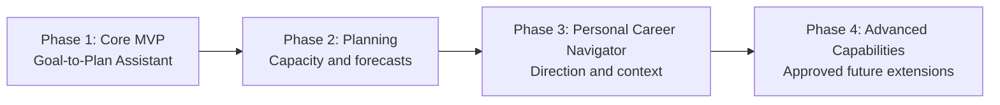

# Trajectory — Phased Implementation Roadmap

> **Status: Roadmap draft for review. No implementation is authorized by this file.**
> Sources: [Product.md](Product.md), [Architecture.md](Architecture.md), [Database.md](Database.md), [AI_Integration.md](AI_Integration.md), [Rules.md](Rules.md), and [DECISIONS.md](DECISIONS.md). Technical proposals and open decisions in those documents remain open.

## 1. Direction and scope

The user's latest roadmap request defines **Phase 1 as a Goal-to-Plan Assistant**: capture a goal, generate task/milestone proposals with an open-weight model, review/edit/approve, and record progress with restart persistence. The complete career navigator remains part of the long-term vision.

Product.md's proposed MVP currently includes broader daily planning and navigator capabilities. This roadmap stages those proposed release details across Phases 1–3; it does not remove confirmed product capabilities or silently rewrite other documents. Before implementation, separately authorize any needed source-document alignment, including milestone representation and the simpler Phase 1 plan contract. DECISIONS.md's existing MVP/open-choice entries are not updated by this file.

| Phase | Goal | Release boundary |
| --- | --- | --- |
| 1 · Core MVP | Turn a goal into approved, persistent work that can be tracked. | An ordered work plan, not yet a time-slot schedule or full career navigator. |
| 2 · Planning | Fit work into real capacity and adjust using evidence. | Daily schedules, commitments, overload, planned-versus-actual and forecasts. |
| 3 · Personal Career Navigator | Connect planning with an editable, multi-interest personal trajectory. | Confirmed context, alignment advice, decisions and intentional detours. |
| 4 · Advanced Capabilities | Extend the full vision through separately approved increments. | Historical retrieval, richer roadmap support and other explicitly selected future features. |

The “eight weeks” in the example goal is user input to clarify, not a project delivery deadline or a guaranteed learning outcome. No calendar schedule or phase-duration promise is made here.

## 2. Tracking and a sustainable working rhythm

| Task status | Use it when |
| --- | --- |
| Not Started | No implementation work/evidence is recorded. Dependencies may still be pending. |
| In Progress | The user has authorized this scope and work has actually begun. Keep only one implementation task active. |
| Blocked | Work cannot proceed; record the specific missing approval, information or technical prerequisite. |
| Complete | Completion criteria have verified evidence and the result has been reported for user review. Completion does not authorize the next task. |

**Current tracking:** P1.01 is **In Progress** for the authorized prerequisite review; all other tasks remain **Not Started**. Existing documentation is preparation, not evidence that an application feature works. Dependency links describe order; they do not invent a failed attempt or a blocker already encountered.

For later phases, retain the learning pace of a few hours per week. **Phase 1 has a newer user-supplied constraint: three days at 2–3 hours daily (6–9 total hours).** This is available build time, not a verified challenge deadline or a delivery guarantee. Within either pace:

- Select one small outcome per available session; there is no required weekly output. Split a large row into separately authorized steps rather than trying to finish a whole phase at once.
- Prefer one end-to-end working slice over building every layer in isolation. Add only the schema/modules needed for that slice; preserve modular responsibilities without scaffolding future infrastructure.
- Finish by noting what was learned, what was verified, and the next small action in the authorized report/task update. Follow Rules.md's learning-comment and verified-line reporting policy.
- Check the relevant failure path with the feature, rather than postponing reliability to a final cleanup phase. Reserve time for review and debugging; optional work must not delay required phase completion.
- Work on one authorized file/change scope at a time. A task row is not blanket permission to edit every related file. Request the concrete implementation scope, finish it, report, and wait for approval. Task-status edits also require authorization if outside that scope.

## 3. Phase 1 — Core MVP

**Goal:** A usable Goal-to-Plan Assistant, before the full scheduling engine or personal navigator.

**Included:** Natural-language goal capture; missing-information questions; real open-weight task and milestone suggestions; editable drafts; exact user approval; task completion and actual-work records; reopening saved work after restart. Basic validation, correction/deletion, safe configuration and graceful failures apply from the first persisted/personal record.

**Dependencies:** Approve the phase boundary and necessary contract/schema alignment; resolve the minimum stack, model/license/runtime, persistence, demo and interaction decisions. Design.md remains deferred until separately authorized; do not invent its visual direction here. Official challenge requirements must be checked before calling a demo challenge-ready.

### Required for Phase 1

| ID | Task and included feature | Depends on | Completion criteria | Status |
| --- | --- | --- | --- | --- |
| P1.01 | Review the reduced first-release boundary and unresolved prerequisites in small decision sessions. | User input | Phase 1 scope, minimum interaction design, stack/storage, model selection evidence and demo boundary are explicitly approved. Necessary Product/Database/AI contract alignment is separately authorized and reviewed; milestone and non-calendar plan representation are settled without inventing fields here. | In Progress |
| P1.02 | Establish the smallest modular application and persistence slice. | P1.01 | Approved configuration starts successfully; a validated goal can be saved/reopened using the approved persistence mechanism; meaningful persistence/validation checks are recorded. No future-phase scaffolding is required. | Not Started |
| P1.03 | Capture a goal and clarify missing information. | P1.02 | The user can enter a goal such as learning ML and building a portfolio project; ambiguous target dates and missing available hours are clarified. Stated values and unknowns remain distinct; no inferred details are silently saved as confirmed facts. | Not Started |
| P1.04 | Connect one verified eligible open-weight candidate through the isolated adapter. | P1.01–P1.03 | The exact artifact/license/runtime route has recorded evidence; a real bounded request returns a validated extraction/proposal or an actionable failure. Hardware/host behavior is actually checked, not assumed from documentation. | Not Started |
| P1.05 | Generate an ordered draft with tasks and reviewable milestones. | P1.04 | Real model output proposes actionable work and milestone checkpoints under the approved contract. Missing effort/deadlines/hours produce clarification; invalid output or omitted required information is rejected or flagged. Milestones are proposals, not forecast guarantees. | Not Started |
| P1.06 | Review, edit and approve the exact proposed plan. | P1.05 | Edits are revalidated; unapproved suggestions stay drafts; acceptance persists only the confirmed revision. Declining, stale input, duplicate acceptance and save failure do not overwrite prior accepted work. | Not Started |
| P1.07 | Track and reopen actual work. | P1.06 | The user marks tasks complete, records/corrects actual work and time separately, and reopens goal/plan/progress after restart. Unknown remaining work stays unknown; changes/removal follow approved dependent-record rules. | Not Started |
| P1.08 | Verify the complete first-release loop and its failure paths. | P1.02–P1.07 | Recorded evidence covers goal -> real proposal -> edit/approve -> progress -> restart. Test malformed/unavailable inference, missing data, rejected approval, persistence failure and stale/duplicate acceptance. Document actual limitations and challenge evidence; no fake-adapter-only claim of real integration. | Not Started |

### P1.01 prerequisite review — started 2026-10-18

**Review state:** In Progress. Only Tasks.md is being updated; implementation and other-document alignment remain unauthorized. The user explicitly approved the local single-user app and Python/Flask/Jinja/SQLite stack with Pydantic/pytest. Read-only hardware identification was completed; no model/license/runtime or inference performance is verified.

| Prerequisite | Review finding / recommendation | Approval or evidence still needed |
| --- | --- | --- |
| Phase 1 boundary | **Confirmed direction:** Goal-to-Plan Assistant: capture, clarify, real task/milestone proposal, edit/approve, track actual work, reopen after restart. Daily scheduling/forecasts stay Phase 2; navigator stays Phase 3. | Preserve this allocation when separately updating the broader proposed-MVP wording in Product.md. |
| Stack and persistence | **CONFIRMED by explicit user reply:** Python, Flask/Jinja, modular browser assets, SQLite/sqlite3 and the proposed Pydantic/pytest validation/testing tools. | Exact compatible dependency/Python versions remain unselected; code and installation need separate authorization. |
| Demo boundary | **CONFIRMED by explicit user reply:** Local single-user Phase 1 app; hosted deployment/accounts are not Phase 1 requirements. | Local app approval does not select a local/remote inference route or establish challenge eligibility. |
| Challenge and time constraints | **User supplied:** three days to build Phase 1, 2–3 hours daily, giving 6–9 total hours. Official challenge rules/submission deadline and spending limits remain unknown. This supersedes the weekly pace for Phase 1 only; no completion guarantee is made. | Official challenge link/deadline if applicable, or confirmation there is no active challenge; whether inference must be free and any approved spending limit. |
| Model/runtime | **Observed on the workspace machine:** Windows reports Lenovo model 83DV, i5-13450HX and 15.7 GiB usable RAM; nvidia-smi reports RTX 3050 6GB Laptop GPU with 6144 MiB VRAM. Colab may be considered if needed. | Confirm intended host if a different device will be used; establish free/paid inference limits and candidate/license/runtime evidence. Hardware identification is not measured model fit/latency. Colab suitability remains unverified. |
| Persistent Phase 1 plan | **Gap:** Database.md 3.7–3.9 requires a dated daily plan and time allocations/blocks. An ordered goal work plan before time-slot scheduling is not explicitly represented. | Separately authorize Database.md alignment to propose durable ordered plan/task membership, acceptance/version semantics and later daily-plan linkage. Do not force a fake calendar date to fit the present proposal. |
| Milestones and AI output | **Gap:** AI_Integration.md 4.3 extracts work/tasks/interests/preferences and plans existing task allocations; it has no explicit milestone item or complete ordered goal-plan contract. | Separately review AI contract and schema alignment. Prefer a lightweight checkpoint associated with ordered work over a new roadmap graph, but the representation is still OPEN DECISION. |
| Interaction design | Design.md remains intentionally deferred. No layouts, pages or transitions are approved by this review. | User's minimum interaction/design direction before dependent frontend implementation; propose its documentation only when authorized. |
| Verification | Testing.md exists and maps T1.01–T1.13 to Phase 1; no checks have been executed. The proposed evaluation counts/limits remain open. | Review test-plan details and approve phase-relevant quality/runtime budgets before comparison or release claims. |
| Record alignment | Source documents still label the stack/local-user direction open, although the user has now explicitly approved them. Model/runtime and detailed schema policies remain open. | Separately authorize decision-log/source alignment; this review records approval without editing those files. |

**Answers received:** Three days at 2–3 hours daily; explicit approval of the local app and proposed stack/tools; tentative 16 GB RAM; Colab may be considered. Read-only Get-CimInstance and nvidia-smi checks identified the workspace hardware above. No model load, inference benchmark, license or challenge eligibility was verified.

**Questions still pending:** Whether inference must be free; official challenge rules/deadline if applicable; whether another machine will host inference. Model/runtime, minimum design and schema/contract alignment remain open. No missing answer implies approval or establishes a calendar submission date.

**Time-budget review:** A 6–9 hour window leaves little room for runtime troubleshooting, design iteration and source alignment while learning. Keep Phase 1 to the four approved outcomes and required validation/failure paths. Do not implement the full 12-table proposal, future context/RAG, accounts, hosting or calendar scheduling just to prepare for later phases. Prefer one end-to-end slice and one inference route; choose that route only after the missing inputs and a small authorized feasibility check. Do not bypass the real-model requirement with a mock if inference is not ready; report the limitation and ask about scope/time instead.

**Proposed session order, not a promised schedule:** First resolve the minimum decisions/contracts and goal save/reopen slice; next connect real generation and review/approval; then add actual-work tracking and rehearse restart/error paths. Each session can contain separately authorized small changes. Reserve time for integration/debugging rather than treating all available hours as feature time. P1.O1 stays optional; later phases remain visible and unchanged.

**Recommended next review order:** Local demo/stack are approved. Resolve inference budget/challenge inputs and compare feasible candidates next; review non-calendar plan/milestone representation through one authorized document at a time, then minimum design and evaluation scope. Actual model load/latency evidence needs a separately authorized feasibility check/P1.04.

**Exit condition unchanged:** P1.01 is not Complete until its required decisions and separately authorized source alignment have evidence. Do not begin P1.02 or install dependencies while those prerequisites remain unresolved. If progress cannot continue after the decision discussion, record the specific missing input and mark this task Blocked; do not mark the whole roadmap complete.

### Optional if time permits — separately authorized

| ID | Small enhancement | Depends on | Completion criteria | Status |
| --- | --- | --- | --- | --- |
| P1.O1 | Add a few more synthetic examples and improve the explanations of milestones/clarification. | P1.08 | Approved cases show more understandable output without expanding contracts, adding screens/frameworks or weakening validation; record results honestly. | Not Started |

**Phase 1 completion:** P1.01–P1.08 meet their criteria and the user reviews the end-to-end result. A real model meaningfully generates work suggestions; no plan is accepted without confirmation; saved records survive restart. Phase 2/3 features are not Phase 1 exit gates. If official challenge rules require more, report the conflict before labeling this scope submission-ready.

## 4. Phase 2 — Planning

**Goal:** Turn approved work into realistic daily schedules and evidence-based expectations.

**Included:** Courses/projects/goals and competing work, priorities/deadlines, available intervals, recurring commitments, editable daily schedules, overload detection, planned-versus-actual comparison, completion forecasting and adaptive replanning.

**Dependencies:** Reviewed Phase 1; approved time/recurrence/deadline semantics, effort/progress units, deterministic placement policy, forecast evidence rules, and the relevant schema/contract changes. Existing proposals about SQLite, recurrence and forecast formulas are not automatically final.

### Required for Phase 2

| ID | Task and included feature | Depends on | Completion criteria | Status |
| --- | --- | --- | --- | --- |
| P2.01 | Organize multiple goals, courses/projects and actionable tasks. | Phase 1; scope/data review | Users manage competing work with reviewed priorities/deadlines and resource references. Existing Phase 1 data is preserved through any approved migration. | Not Started |
| P2.02 | Capture availability and recurring commitments. | P2.01; time-policy approval | Validated windows expand correctly for the approved horizon/timezone; overlapping availability does not double-count capacity and commitments cannot create negative capacity. Test approved DST/overnight rules. | Not Started |
| P2.03 | Generate and edit daily plans with deterministic placement/validation. | P2.02; scheduling-policy approval | AI recommendations feed application-owned scheduling; both generated and user-edited blocks are checked against current availability, commitments, deadlines and overlaps before acceptance. No invalid accepted schedule in the relevant checks. | Not Started |
| P2.04 | Detect overload and show planned-versus-actual progress. | P2.03; P1.07 | Submitted work is not silently dropped; report unallocated requested work and shortfall. Compare planned allocations with actual records without equating elapsed time and completed quantity. | Not Started |
| P2.05 | Calculate evidence-based completion forecasts. | P2.04; forecasting-policy approval | Calculate from comparable recorded progress, remaining workload and explicit future capacity. Show basis/uncertainty; insufficient evidence or incompatible units yields an explanation, not a model-invented date. Corrections update results. | Not Started |
| P2.06 | Support adaptive replanning and verify the planning loop. | P2.03–P2.05 | Changes in progress/capacity can produce a revised editable proposal; acceptance preserves historical plan/actual distinctions. Tests cover overload, no capacity, stale revisions, rollback and revised forecasts. | Not Started |

### Optional if time permits — separately authorized

| ID | Small enhancement | Depends on | Completion criteria | Status |
| --- | --- | --- | --- | --- |
| P2.O1 | Expand deterministic boundary/regression examples beyond required coverage. | P2.06 | Additional difficult schedule/forecast cases have recorded expectations/results; no new recurrence engine or predictive model is introduced. | Not Started |

**Phase 2 completion:** P2.01–P2.06 are verified and reviewed. Daily plans are feasible or explain the capacity gap; actuals inform transparent numerical estimates; changes never silently replace accepted plans. Model output does not become the numerical authority.

## 5. Phase 3 — Personal Career Navigator

**Goal:** Make planning aware of the user's flexible career direction while preserving their control.

**Included:** Multiple career interests; natural-language ambitions and changing priorities; courses/playlists/projects/resource links; confirmed preferences, decisions and reasons; intentional detours with duration/review dates; relevant progress history; inspectable persistent context and respectful alignment advice.

**Dependencies:** Reviewed Phase 2; approved context/confirmation/retention policies and schema/contracts. Use existing context/repository interfaces; historical-note RAG is not a prerequisite.

### Required for Phase 3

| ID | Task and included feature | Depends on | Completion criteria | Status |
| --- | --- | --- | --- | --- |
| P3.01 | Create the editable multi-interest trajectory profile. | Phase 2; context-policy approval | User-confirmed interests, priorities, resources and preferences persist and can be inspected/corrected. No single career path is forced; no full chat archive is assumed. | Not Started |
| P3.02 | Review natural-language trajectory changes and record decisions/reasons. | P3.01 | Proposed updates show exact changes before confirmation; important goals/commitments cannot change silently. Historical decisions are distinguishable from current priorities. | Not Started |
| P3.03 | Compare new activities and plans with current priorities. | P3.02 | Advice identifies relevant saved support, labels interpretations and asks when evidence is insufficient. An unfamiliar topic alone is not a distraction; no shaming or automatic priority mutation. | Not Started |
| P3.04 | Record and respect intentional explorations. | P3.03 | Confirmed detours save reason/scope and supplied duration/review date; users can revise/remove them. Later advice respects them; due review dates prompt review without automatically changing commitments. | Not Started |
| P3.05 | Ground daily planning in relevant current context. | P3.01–P3.04; P2.06 | Bounded repository retrieval supplies current priorities, decisions, detours and relevant progress with valid source references. Suggestions remain editable and pass the unchanged deterministic scheduling/forecasting boundaries. | Not Started |
| P3.06 | Verify correction/deletion and navigator behavior end to end. | P3.05 | Users can inspect, correct and request deletion of context; dependent summaries/drafts and in-flight results stop using stale/deleted content. Show honest pending/completed cleanup status. Evaluate conflicting context, new fields and intentional exploration with fake and real adapters as appropriate. | Not Started |

### Optional if time permits — separately authorized

| ID | Small enhancement | Depends on | Completion criteria | Status |
| --- | --- | --- | --- | --- |
| P3.O1 | Refine approved summaries and source explanations using more synthetic cases. | P3.06 | Better readability/grounding is demonstrated without introducing historical-chat retrieval or automatically rewriting confirmed preferences. | Not Started |

**Phase 3 completion:** P3.01–P3.06 are verified and reviewed. Plans use inspectable current context; the user controls changes/detours and deletion; all earlier constraints and deterministic calculations remain intact.

## 6. Phase 4 — Advanced Capabilities

**Goal:** Preserve and explore the full vision through small, separately approved extensions after the core planning/navigator loops work.

**Dependencies:** Reviewed Phase 3; a demonstrated user need and explicit scope for each extension, plus its storage/privacy, model/runtime and testing decisions. No advanced feature becomes a Phase 1 requirement or an automatic implementation commitment.

### Required for Phase 4

| ID | Task | Depends on | Completion criteria | Status |
| --- | --- | --- | --- | --- |
| P4.01 | Select one advanced extension and define its release boundary. | Phase 3; user selection | The user explicitly approves included/excluded behavior, data retention/deletion needs, acceptance criteria and a small first slice from the retained vision below. | Not Started |
| P4.02 | Deliver and evaluate only the selected slice. | P4.01 | Separately authorized implementation, necessary migrations/contracts and regression checks satisfy the selected criteria; Phase 1–3 behavior remains verified. Report evidence and limitations before selecting another extension. | Not Started |

### Optional candidate increments — retained vision, not approved release scope

Each row is optional until selected through P4.01. It then becomes required only for that selected slice, not for every Phase 4 release.

| ID | Future feature | Dependencies | Completion criteria if selected | Status |
| --- | --- | --- | --- | --- |
| P4.O1 | Retrieve relevant historical notes or selected conversation context. | P4.01; retention/access/source policy | Inspectable retrieved evidence is relevant, access-scoped and correctable/deletable; distinguish history from current commitments. Evaluate text search first; embeddings/vector storage only if justified. Never promise hallucination-free advice. | Not Started |
| P4.O2 | Suggest longer-term learning-roadmap changes. | P4.01; grounded context, optional relevant history | Suggestions link to goals/prerequisites/evidence and remain editable; confirmed changes require approval. Roadmap suggestions do not replace deterministic forecasts or invent supported prerequisites. | Not Started |
| P4.O3 | Review richer explorations and changing directions over time. | P4.01; decisions/detours history | Users can review multiple experiments and their recorded reasons/outcomes without punitive classification or automatic career-path decisions. | Not Started |
| P4.O4 | Explore the creative-practice journal with sketches and development history. | P4.01; separate media/storage/privacy/design approval | Approved journal slice saves/reopens sketches and user-entered development records with appropriate correction/deletion controls. No claim of validated artistic improvement is made. | Not Started |

**Phase 4 completion:** P4.01–P4.02 and the acceptance criteria of the selected candidate are verified and reviewed. Phase 4 is repeatable; it does not require building every candidate at once. Unselected features remain visible here.

## 7. Visible exploratory backlog

These items were mentioned as possible enhancements/alternatives in the setup documents. They remain **exploratory**, not confirmed product commitments. Their inclusion preserves visibility without adding requirements to Phase 1 or to Phase 4's selected release.

| ID | Candidate | Dependency / decision before scheduling | Completion criteria if later approved | Status |
| --- | --- | --- | --- | --- |
| B01 | External calendar synchronization, notifications or richer recurrence/exceptions. | Explicit need; integration/design/security review after Phase 2 | Approved selected behavior interoperates with existing capacity/commitment rules and handles failure without corrupting schedules. | Not Started |
| B02 | Specialized course tooling, recurring-task automation or many-to-many resource organization. | Scope/data-model approval after actual usage | A narrowly selected workflow is verified; no duplicate authoritative progress totals or silent task creation. | Not Started |
| B03 | Historical forecast snapshots and richer roadmap relationships. | Forecast/schema approval after Phase 2/3 evidence | Approved history/relationships are interpretable and survive correction/deletion policies without presenting stale estimates as current. | Not Started |
| B04 | Hosted multi-user access or collaboration. | Explicit product/deployment approval; identity, authorization and storage redesign | Access isolation/security and durable deployment are verified before exposure; the single-user profile is not reused as a security boundary. | Not Started |

## 8. Gates before the next implementation step

1. Review this phase allocation. It preserves the product vision while following the latest narrower first-release request; any necessary Product.md/Database.md/AI_Integration.md/DECISIONS.md alignment needs its own authorized scope.
2. Resolve only decisions needed for the next slice, referencing DECISIONS.md rather than silently selecting Flask, SQLite, Ollama, a model or a hosting route here.
3. Plan/authorize the needed design and test documentation before their dependent implementation; neither is created by this roadmap. No final pages, components or interactions are specified here.
4. Request a concrete small implementation scope. No task status changes to In Progress until that scope is authorized and work begins; Complete requires actual evidence, not an optimistic checkbox.
5. After the authorized result, report changed files and verified ranges, actual tests/results, learning notes and remaining questions, then stop for review. Updating another document or starting the next phase is never automatic.

The only build window recorded is the user-supplied three days at 2–3 hours daily for Phase 1. No official submission deadline, guaranteed delivery estimate, completed application feature or test outcome is asserted by this roadmap.