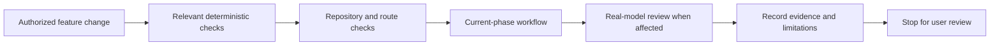

# Trajectory — Testing Plan

> **Status: Draft for review. No application tests, model evaluations or benchmarks have been run for this document.**
> Basis: [Product.md](Product.md), [Architecture.md](Architecture.md), [Database.md](Database.md), [AI_Integration.md](AI_Integration.md), [Rules.md](Rules.md), [DECISIONS.md](DECISIONS.md), and the approved [Tasks.md](Tasks.md) roadmap. Their unresolved technical choices remain open. This file creates no tests, fixtures, tools, application code or other files.

## 1. Test the current phase, preserve the full vision

The approved roadmap makes Phase 1 a **Goal-to-Plan Assistant**: capture a goal, obtain real open-weight task/milestone suggestions, review/edit/approve, track actual work, and reopen saved records after restart. Phase 2 adds time-slot scheduling and forecasts; Phase 3 adds the persistent career navigator; Phase 4 tests only individually approved extensions.

Product.md and the proposed database/AI contracts still describe a broader initial slice. Tasks.md already identifies required source-document alignment, including milestones and non-calendar plans. Until separately approved, do not invent schema fields or final contracts to make a test pass. Specify the expected behavior here; mark dependent executable checks as Blocked when their missing contract actually prevents execution.

This describes a verification path, not a requirement to run every test for every edit. Select checks by risk and changed behavior; do not repeatedly run broader suites without a reason.

## 2. Test layers and boundaries

| Layer | Verify | Isolation / evidence |
| --- | --- | --- |
| Unit | Validation, state transitions, pure calculations and output-contract checks. | Explicit inputs/time; no real network/model/database where unnecessary. |
| Service and route | Approval workflows, exact versions, errors, source checks and persistence coordination. | Fake adapter; temporary database when persistence matters. Assert saved state, not just response text/status. |
| Repository | Constraints, relationships, transactions, correction/deletion, migration and restart behavior. | Disposable database files; enable/verify FK enforcement on every connection if SQLite is selected. |
| Browser workflow | The user can enter, edit, approve, correct and reopen work with understandable feedback. | Manual checklist initially; automate only when the interaction design and repeated need justify it. |
| Real-model evaluation | Observed usefulness, extraction/clarification, grounding, variability, latency and meaningful live integration. | Exact candidate/settings and synthetic cases; separate from deterministic tests. |

pytest remains a **proposed** runner from Architecture.md; no installation/version selection is made here. Keep tests under the architecture's proposed unit/integration/workflow groups when implementation is authorized. Do not enforce arbitrary test-file counts, blanket coverage percentages or full-string snapshots of model prose.

## 3. Safe fixtures and repeatability

- Use synthetic goals, preferences, notes and progress only. Never test migrations/deletion against a personal live database or send real personal context to an unapproved provider.
- Use fixed clocks, explicit timezones, known capacities and finite quantities. Inject time and adapters rather than relying on the host date, mutable globals or a running model.
- Test persisted behavior using a temporary on-disk database when restart durability matters; an in-memory database alone cannot prove it. Close/reopen the connection and restart the application against the same disposable file.
- Use small reusable fixtures: a valid goal, an accepted plan, a pending proposal, two source versions, and actual-work entries. Add scheduling/navigator fixtures only with their phase. Do not prebuild future schema.
- Fake adapter outcomes must include valid, malformed, oversized/incomplete, timeout, unknown-reference and stale-result cases. Simulated errors are not evidence of measured real-runtime behavior.
- Keep model evaluation cases and expected facts separately from prompt-tuning examples. Record exact runtime/model, prompt/schema version, generation settings and fixture/test version for reproducibility.

## 4. Phase 1 — Core MVP acceptance checks

All checks below start **Not Run**. These are planned tests, not claims of implemented features. The roadmap task column connects each check to its required behavior.

| Test ID | Scenario | Observable pass condition | Roadmap task |
| --- | --- | --- | --- |
| T1.01 | Capture a natural-language goal with stated target and available hours. | Preserve stated details for review; validate required fields. Ambiguous relative dates are resolved using approved timezone/date rules and user confirmation, not an inferred server default. | P1.03 |
| T1.02 | Omit available hours/deadline or provide contradictory information. | Ask focused clarification; missing values remain unknown. No guessed commitment becomes a saved fact. | P1.03/P1.05 |
| T1.03 | Generate task and milestone proposals with the real selected model. | A live call through the isolated adapter supplies actionable reviewable suggestions under the approved contract. A milestone is not a guaranteed completion date. Record exact model/runtime evidence. | P1.04/P1.05 |
| T1.04 | Edit and decline a proposal. | Edits are revalidated; declined/unconfirmed suggestions do not become accepted work. Prior accepted work is unchanged. | P1.06 |
| T1.05 | Approve the exact revised proposal. | Only the displayed confirmed revision is applied atomically; a repeated acceptance does not duplicate goals/tasks/plans. | P1.06 |
| T1.06 | Change a source or edit from a second request before approval. | Stale versions are rejected with a review path; no lost update or acceptance of an unseen revision. | P1.06 |
| T1.07 | Receive invalid JSON, extra fields, unknown targets, invalid quantities or incomplete/oversized output. | Reject the result before mutation; identify clarification/retry/manual options. No partial proposal application or generated-code execution. | P1.04–P1.06 |
| T1.08 | Model unavailable or timed out. | Bound the wait by the approved limit; preserve data and allow manual editing/user-triggered retry. No automatic infinite repair loop or false success. | P1.04/P1.08 |
| T1.09 | Mark a task complete and record/correct actual work. | Completion, completed quantity and time spent remain distinct. Persist corrections using approved rules; reject negative/non-finite values and empty actual-work entries. | P1.07 |
| T1.10 | Restart after saving a goal, accepted plan and actual work. | Reopen the same records and values from the disposable durable store, not cached browser/process state. | P1.02/P1.07 |
| T1.11 | Correct/delete saved data through the approved dependent-record workflow. | Preview relevant consequences; preserve independently recorded actuals unless their deletion was explicitly selected. Removed content does not remain authoritative in proposals or derived copies. | P1.07 |
| T1.12 | Fail persistence during acceptance or progress correction. | Roll back incomplete changes; preserve previous valid data. A successful save followed by a calculation/display failure is reported separately, not falsely as an unsaved or duplicated write. | P1.06–P1.08 |
| T1.13 | Complete the first-release workflow with synthetic data. | Capture -> clarify -> real proposal -> edit -> approve -> record actual work -> restart -> reopen. User review finds usable feedback and no hidden automatic acceptance. | P1.08 |

**Phase 1 boundary:** Daily calendar placement, full overload/forecast algorithms, trajectory memory and advanced RAG are not Phase 1 exit requirements. Their tests remain visible below. Validation, approval, safe personal-data handling and persistence are required as soon as corresponding records exist.

## 5. Phase 2 — Planning and forecasting checks

Status: **Not Run; later-phase scope.** Executable cases depend on approved time, recurrence, deadline, progress-unit and forecast policies. Do not silently choose those policies as test expectations.

| Test ID | Scenario / fixed example | Observable pass condition | Roadmap task |
| --- | --- | --- | --- |
| T2.01 | Organize goals, courses/projects, standalone and related tasks/resources. | Valid relationships/ownership; edits preserve existing Phase 1 records and progress. | P2.01 |
| T2.02 | Availability 09:00–11:00 and 10:00–12:00; commitment 10:30–11:00, on a fixed ordinary local day. | Union availability = 180 minutes; usable capacity = 150, not a sum that double-counts overlap. Commitments outside availability do not make capacity negative. | P2.02 |
| T2.03 | Weekly/one-off rules, midnight boundaries, DST ambiguity and invalid date/zone. | Approved recurrence policy is followed; unsupported/ambiguous input is clarified or rejected. No silent host-timezone conversion. | P2.02 |
| T2.04 | Generated or edited blocks overlap, exceed capacity, conflict with commitments or violate effective deadlines. | Deterministic code rejects invalid acceptance; prior accepted plan survives. Boundary cases use the approved interval semantics. | P2.03 |
| T2.05 | Request 180 minutes against 150 usable minutes. | All requested tasks remain represented; report at least 30 unallocated minutes, or more if other constraints prevent fitting. Distinguish work not requested today from requested work that could not fit. | P2.04 |
| T2.06 | Model omits a submitted task, invents an ID or exceeds allowed effort. | Do not silently drop work or trust arithmetic; flag/reject the proposal and calculate allocations/shortfall in code. | P2.03/P2.04 |
| T2.07 | Compare an accepted plan with actual work, then replace it. | Show planned versus actual without rewriting original history; replacement requires acceptance; duplicate requests create at most one current accepted plan for the approved day/key. | P2.04/P2.06 |
| T2.08 | Forecast with a reviewed fixed progress/capacity dataset. | Result matches a hand-calculated oracle for the approved formula and rounding; expose inputs/assumptions. Changing model prose cannot change the number/date. | P2.05 |
| T2.09 | No history, zero future capacity, incompatible units or missing remaining work. | An explicit missing-data/unavailable or policy-defined uncertainty result, never an invented date or division error. | P2.05 |
| T2.10 | Correct actuals/remaining workload or reduce future availability. | Recompute from corrected evidence; proposed replanning is editable and independently revalidated. No silent commitment changes. | P2.05/P2.06 |

Do not define a numerical forecast oracle until the formula, minimum evidence and units are approved. Retain cases for both sufficient and insufficient evidence; do not make tests pass by substituting language-model predictions.

## 6. Phase 3 — Career Navigator and persistent context

Status: **Not Run; later-phase scope.** Historical-chat RAG is not required for these checks.

| Test ID | Scenario | Observable pass condition | Roadmap task |
| --- | --- | --- | --- |
| T3.01 | Save multiple interests, priorities, learning resources and preferences; restart. | Inspectable current records persist, remain editable and do not force one career field. | P3.01 |
| T3.02 | Propose an important long-term goal/commitment change, then decline it. | Show exact before/after and require approval; declining leaves confirmed state intact. Old decisions are historical, not automatically current priorities. | P3.02 |
| T3.03 | Add a new subject with weak or conflicting support. | Cite relevant current evidence where practical, label interpretation and ask whether exploration is intentional. No shaming, automatic distraction labels or invented preferences. | P3.03 |
| T3.04 | Confirm a scoped detour, revise/remove it, or reach its review date. | Advice respects its confirmed scope; review date prompts review without changing goals. Subsequent advice reflects approved correction/removal. | P3.04 |
| T3.05 | Retrieve current records alongside stale summaries and old/conflicting notes. | Access-scoped selection respects versions/status; do not promote historical statements to commitments. Clarify unresolved conflict; citations must actually support the interpretation under human review. | P3.05 |
| T3.06 | Correct/delete a source while generation is in flight or before approval. | Stale result is discarded/regenerated; source excluded before display/acceptance. Dependent summaries, drafts, caches and any active index stop influencing advice after cleanup. | P3.06 |
| T3.07 | Cleanup fails after a deletion request. | Pending/failed targets stay excluded; completion is not falsely reported. Controlled retry finishes required cleanup before completed status. | P3.06 |
| T3.08 | Use trajectory/detours in a new daily plan. | Context changes suggestions, while the same deterministic constraints/forecasts and explicit acceptance continue to apply. | P3.05/P3.06 |

## 7. Phase 4 and retained future tests

Run only for an explicitly selected extension under P4.01–P4.02; all are **Not Run**. Unselected future features do not block an earlier phase.

| Candidate / roadmap link | Checks required if selected |
| --- | --- |
| Historical notes/conversation retrieval · P4.O1 | Review retrieval relevance/source recall, access isolation, stale/conflicting evidence, correction/deletion propagation and supporting excerpts. A matching citation does not establish semantic correctness or eliminate hallucinations. |
| Longer-term roadmaps · P4.O2 | Suggestions have valid supporting goals/prerequisites/evidence; edits/approval remain available; no model-generated completion promises replace forecasts. |
| Richer exploration reviews · P4.O3 | Multiple experiments retain reasons/outcomes and user control without punitive labels or automatic career changes. |
| Creative-practice journal · P4.O4 | Approved media types/limits, safe storage/rendering, save/reopen, correction/deletion and access boundary; no unsupported claim of improved artistic skill. |
| Exploratory backlog · B01–B04 | Add only the approved feature's cases: calendar/integration failure; recurring-task duplicates; historical estimates; or multi-user isolation/security as applicable. Do not build these fixtures/infrastructure now. |

## 8. Cross-cutting integrity and security

Apply these checks when the relevant surface is implemented, beginning in Phase 1. They are requirements for containment, not permission to add accounts, services or future features.

| Area | Observable checks |
| --- | --- |
| Repository integrity | Required/conditional fields, finite values, valid FK/ownership links, status transitions, unique acceptance and transaction rollback. A service must validate JSON source references that the DB cannot enforce as FKs. |
| Versions and deletion | Stale updates fail; correction invalidates derived data under the approved policy; archive is not deletion. Source text must not survive unnoticed in copied notes/outputs. |
| Migrations and restore | Approved migrations preserve disposable representative data; startup never silently resets a real DB. Test restoring backups against the approved deletion policy before claiming deleted content cannot return. |
| Untrusted content | Script/HTML-like titles and injected notes are escaped/treated as data; no generated SQL/code execution, arbitrary tool/file/network actions or automatic resource-link fetching. |
| Browser mutations | CSRF protections and session-cookie settings when applicable; same-origin policy; reads do not mutate commitments. Assert unchanged persistent state after rejected requests. |
| Configuration | Missing/invalid settings fail clearly; secrets do not reach browser assets/logs/errors. Endpoint/model selection is server-controlled and bounded. |
| Exposure boundary | Local single-user demo stays within the approved local boundary. Before a public/multi-user release, test identity/access isolation, transport/storage and abuse limits; a singleton profile is not authorization. |
| Hosted data | Use only an approved provider/destination; disclose what context is sent. No inference of offline/privacy guarantees from a local runtime name. |

## 9. Real-model evaluation without invented results

Follow AI_Integration.md Section 9 rather than duplicating its full rubric. Its **20 synthetic cases, three attempts per final case/candidate and release gates remain proposals**, not automatically approved counts or achieved scores.

| Phase | Real-model evidence needed |
| --- | --- |
| 1 | Goal extraction, missing-information questions, task/milestone usefulness, valid contract behavior and actual bounded runtime performance. Include malformed-output handling through fake adapters separately. |
| 2 | Useful ordering/allocation versus a simple deterministic baseline; constraints must remain contained by code even when model suggestions are poor. |
| 3 | Grounded alignment, respectful exploration questions, confirmed-detour use and no fabricated saved preferences. |
| 4 | Approved extension-specific quality and failure cases, including retrieval semantics if selected. |

Use only phase-relevant evaluation groups for that phase; preserve the remaining groups for later. Approve any adaptation of the proposed dataset/counts before comparing candidates. Hold out final comparison cases from prompt tuning; report all attempts, failed outputs/timeouts and human-review disagreements rather than only the best response.

Record first-response schema validity with a denominator; separate transport failures from semantic quality. Human-review facts, sources, clarification and usefulness. Measure cold/warm end-to-end duration, observed memory and failures on identified hardware. Low temperature or a fixed seed is not a promise of identical generation. Fake tests, runtime availability and good sample output do not verify a license or challenge eligibility.

## 10. Run size and evidence reporting

| When | Verification to run |
| --- | --- |
| Small authorized code change | Directly affected tests plus the relevant regression/failure case. Expand only for shared contracts, uncertainty or new failures. |
| Persistence or acceptance change | Relevant unit checks plus temporary-DB rollback, version/idempotency and dependent-record checks. |
| Prompt/schema/model/runtime change | Contract/service regressions and affected real-model evaluation groups with recorded identities/settings. |
| Phase review/demo | Required current-phase checks, relevant earlier-phase regressions, browser workflow and real integration evidence. |
| Documentation-only change | Read saved content; inspect consistency, references, diagrams and verified line ranges. Application tests are normally unnecessary. |

Do not add a dependency or generate test artifacts outside the authorized scope. If a necessary test/fixture/configuration requires another file, request that concrete scope; do not bypass the workflow. Until commands and paths exist, do not publish fictitious runnable commands or claim that a suite is available.

### Results record for each authorized verification

| Field | Record |
| --- | --- |
| Identity | Test IDs, relevant roadmap task and exact code/contract/model versions where available. |
| Execution | Exact commands actually run, or numbered manual steps; environment and synthetic fixture identity. |
| Outcome | Not Run / Pass / Fail / Blocked. Not Run means not attempted; Blocked includes the concrete missing prerequisite. Neither counts as Pass. |
| Observation | Expected versus actual result, failures/reproduction details, limitations and follow-up approval needed. |
| Coverage boundary | What was not checked; distinguish fake inference from real calls and automation from manual inspection. |

Keep result evidence only in an authorized report/location. This plan contains no populated test results. Roadmap status updates and other-document changes require their own authorized scope when not already included.

## 11. Phase exit and unresolved decisions

A phase is ready for user review only when its required roadmap criteria and applicable tests have actual evidence, failures are resolved or explicitly accepted as scoped limitations, and the completion report identifies unrun/blocked checks. A critical violated constraint, unauthorized mutation or known use of deleted/stale context prevents calling the affected workflow verified; it cannot be hidden in an average score.

- **Phase 1:** Real goal-to-plan generation, exact approval, actual-work tracking, restart durability and relevant failures are verified. No Phase 2/3 feature is silently made an exit gate.
- **Phase 2:** Required deterministic schedule/overload/forecast cases and revised-plan acceptance are verified against approved policies, with earlier regressions checked.
- **Phase 3:** User-controlled context, grounded alignment, detours and deletion/in-flight invalidation are verified, preserving Phase 1/2 behavior.
- **Phase 4:** Only the selected extension's approved criteria and affected regressions are gates; unselected vision/backlog stays visible without becoming mandatory.

Passing a limited test set is not proof of universal reliability, privacy, offline operation or submission eligibility. Submission-ready claims additionally need the official challenge rules and actual evidence.

| OPEN DECISION | Required before dependent execution |
| --- | --- |
| Phase 1 contracts/schema | Settle milestones and persistent non-calendar plans through separately authorized source-document alignment. |
| Tools and interactions | Approve runner/dependencies and minimum interaction design; browser automation is optional until justified. Design.md stays deferred pending authorization. |
| Deterministic oracles | Approve timezone/recurrence/deadline semantics, scheduling policy, units, forecast formula, minimum evidence and rounding. |
| Model/runtime and quality budgets | Verify exact candidate/license/runtime/hardware and approve timeout/context/output limits and practical quality/latency targets. |
| Context and retention | Approve important-change boundaries, deletion/backup/provider policy and source invalidation details. |
| Evaluation scope | Review AI_Integration.md's proposed dataset/repetition counts and phase-specific adaptation before candidate comparison. |

Stop after reporting the authorized verification/document result. A passing phase or approved test plan does not authorize implementation, edits to another document or automatic progression to the next file.